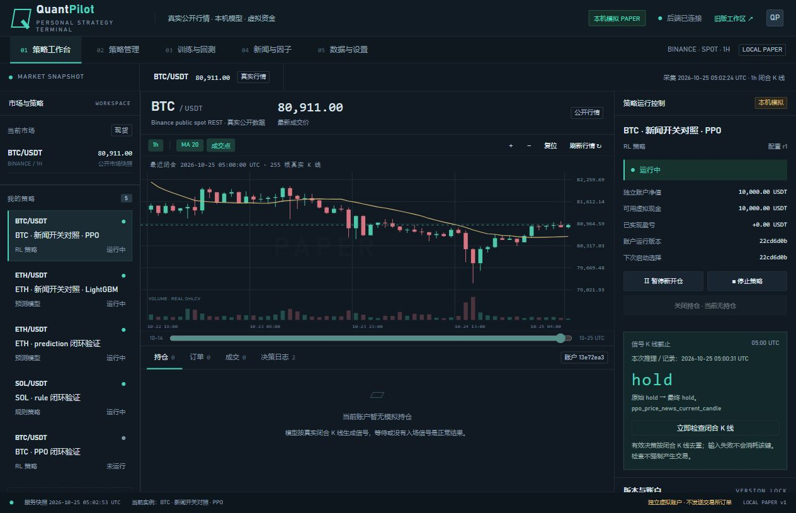
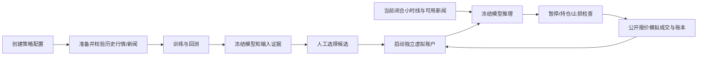

# QuantPilot · 个人量化研究与策略终端

QuantPilot 是一个面向课程项目和个人研究的本机量化平台。用户可以创建规则、预测或强化学习策略，使用公开行情训练和回测，比较新闻因子的影响，再选择一个冻结模型进行虚拟资金模拟。

**当前主要入口：启动后访问 [http://127.0.0.1:8765/terminal/](http://127.0.0.1:8765/terminal/)。** 核心流程不需要交易所账户、交易 API 密钥或 DeepSeek 密钥。新终端使用独立模拟账本，不向交易所发送订单。

**同组成员下载：** 推荐克隆本仓库 `main` 分支以获得最新评估功能。[成员预览版源码包与 SHA256 校验文件](https://github.com/CNnx686/QuantPilot/releases/tag/team-preview-2026-11-17)是较早的固定快照，不含后续评估扩展；其包含源码、文档和依赖锁，不含虚拟环境、下载行情、数据库或已训练模型。私有仓库成员需取得访问权限后下载。



> 上图是开发机已完成真实数据验证的截图。源码仓库不附带该机器的数据库、下载行情、模型或账户；新成员首次启动看到空列表是正常情况，需要按下文创建自己的策略和实验。

## 先了解项目能做什么

| 工作区 | 当前功能 |
| --- | --- |
| 策略工作台 | 当前公开行情、闭合小时线、模型动作、虚拟持仓、订单、成交、决策证据；暂停、恢复与停止 |
| 策略管理 | 创建规则 / PPO / LightGBM 配置，选择现货品种、历史窗口、参数、资金；复制已有配置 |
| 训练与回测 | 实际准备行情、本机训练与评估；收益/回撤、Sharpe/Sortino、预测误差；多窗口/多种子研究；查看错误、取消和重试；手动选择普通任务的冻结候选 |
| 新闻与因子 | GDELT 标题采样、事件来源与可用时间、四列新闻特征、价格 / 价格＋新闻对照 |
| 数据与设置 | 查看数据、服务与环境状态；明确不可用的依赖和能力 |

当前研究市场是 **Binance 现货 USDT 品种、1h 周期**。价格策略可选择有历史数据的品种；新闻模型目前只支持 **BTC/USDT、ETH/USDT**。最多四个活动模拟账户，各自拥有独立资金和账本。

本期尚未完成新终端的运行中模型升级、额外新闻事件风控、自动研究助手、更多周期/交易所或真实资金交易。这些不属于下面主流程的完成范围。

## 核心业务流程



保存配置、训练、选择模型和启动模拟是四个独立动作。新训练结果不会自动替换正在运行的模型；没有入场信号时允许一直空仓。失败、亏损和取消的任务都保留，盈利不作为软件能否运行的准入条件。

## 使用了哪些算法

| 类型 | 当前实现 | 输入与输出 |
| --- | --- | --- |
| 规则基线 | SMA 双均线交叉，默认 12 / 48 小时 | 均线上穿买入、下穿卖出 |
| 预测模型 | LightGBM 回归；最多 100 棵树、15 个叶子、深度 5 | 默认估计未来 6h 收益，按阈值转换成买卖/等待 |
| 强化学习 | Stable-Baselines3 PPO + PyTorch；Actor、Critic 各两层 32 单元 MLP，Tanh | 三个离散动作：等待、买入、卖出；奖励结合净值变化与新增回撤惩罚 |
| 新闻因子 | GDELT 标题关键词分类、按截止时间筛选、去重和 24h 聚合 | 文章数、来源数、监管类文章数、安全类文章数，各做 `log1p` |

价格输入共六列：1/6/24h 收益率、48h 波动率、相对 12/48h 均线偏离。新闻开启后增加四列，模型输入变为十列。新闻功能使用固定标题规则，不把文章计数称为情绪分数；本功能没有调用 DeepSeek。

PPO 采用 CPU 和受限训练步数；本期是可追溯的工程与研究流程，不声称训练出了高频交易或稳定盈利模型。新终端使用 `local_paper_v1`；旧 Freqtrade/FreqAI 研究工作区单独保留，见[旧工作区说明](docs/legacy-workspace.md)。

## 快速开始（Windows）

### 1. 准备工具并克隆仓库

当前安装与启动脚本面向 Windows。已验证的开发路径使用 **Python 3.13、Node.js 22（含 npm）、uv 和 Git**；RL 使用 CPU，不要求 NVIDIA 显卡。其他系统未在本次交付中做完整安装验证。

先确认工具能在 PowerShell 中运行：

```powershell
python --version
node --version
npm.cmd --version
uv --version
git --version
```

仓库为私有仓库时，同组成员需先取得仓库访问权限，并使用自己的 GitHub 账号登录 Git 凭据管理器或 GitHub CLI，再执行：

```powershell
git clone https://github.com/CNnx686/QuantPilot.git
cd QuantPilot
```

也可以下载源码 ZIP，完整解压后在项目根目录打开 PowerShell。后续命令全部从包含 `README.md` 的项目根目录执行，不需要使用开发者原来的磁盘路径。

### 2. 首次安装

```powershell
.\setup.ps1
```

这个脚本会：

1. 创建 `.venv`，按 `requirements.lock` 安装 Python 依赖。
2. 下载并校验基础 BTC/ETH 公开历史行情，供已有研究与环境检查使用。
3. 在 `apps/web` 执行 `npm ci` 和构建旧工作区。当前服务启动器会检查这份构建，所以只使用新终端也应完成此步骤。

首次安装需要网络和下载时间。包下载、Binance 数据下载或前端构建失败时，脚本会退出；先查看明确报错，再重试。源码中的数据清单只是来源/校验记录，并不表示实际数据文件已经随仓库下载。

要使用 **RL / PPO**，在基础安装完成后再执行：

```powershell
.\scripts\setup-rl.ps1
```

该脚本在 `runtime/rl-venv` 创建隔离环境，按 `requirements-rl.lock` 安装 CPU PyTorch、Stable-Baselines3 和 Gymnasium，并检查依赖兼容性及基础数据。只试规则或 LightGBM 时可以暂时不安装 RL 环境。

### 3. 启动和停止

```powershell
.\start.ps1
```

打开 **[个人策略终端](http://127.0.0.1:8765/terminal/)**。新终端的静态文件由 FastAPI 提供，无需另开 Node 服务。

以后已经安装好环境时，直接运行 `start.ps1` 即可。`launch.cmd` 也能启动服务，但它默认打开的是旧工作区；使用新终端请访问带 `/terminal/` 的地址。

```powershell
.\stop.ps1
```

关闭网页不会停止后台训练和模拟。休眠、断网或停止服务会影响运行；服务恢复后不会补成交停机期间错过的信号。请不要同时手动启动多个 worker。

## 同组成员第一次操作

建议先跑一个小范围规则策略，确认环境与行情正常，再试预测和 RL：

1. 打开「策略管理」→「新建策略」，选择**规则策略**、`BTC/USDT`，日期 `2025-01-01` 至 `2025-01-15`，保持默认资金与参数。
2. 保存后进入「训练与回测」→「启动训练与回测」，等待服务端显示成功。首次任务会按需要准备行情，不会直接复制截图中的结果。
3. 查看净值、收益、回撤、交易数和候选证据，点击「选择版本」。
4. 进入「策略工作台」→「启动模拟运行」，检查账户状态、信号截止与决策日志；空仓和 `hold` 都可能是正常结果。
5. 尝试暂停、恢复、停止。账户数据保存在自己的本机，其他组员的账户不会同步到这里。
6. 创建一个**预测模型**或已安装运行环境的 **RL 策略**，继续下面的新闻对照流程。

### 运行新闻开关对照

- 品种选 BTC/USDT 或 ETH/USDT，勾选「将新闻因子实际加入模型输入」，使用推荐窗口 `2025-01-01 → 2025-01-15`。
- 点击「运行价格 / 价格＋新闻对照」。两侧共享行情、费用、资金、参数、种子和时间划分，只改变新闻输入。
- 两侧完整成功后查看收益、回撤和净值差异，再自行选择价格或新闻候选启动模拟。
- 在「新闻与因子」核对文章来源、实际接收时间、覆盖；在决策日志查看该次模型实际使用的新闻输入。

新闻窗口限制为 **14–31 天**；所有开发研究日期须落在 `[2025-01-01, 2025-10-01)`，结束日不包含。2025 Q4 保留区间不会因新建策略而用于开发训练。

新闻来自 UTC 00/06/12/18 各一个 15 分钟批次的固定采样，不是全量新闻。首次当前采集可能晚于最近的小时截止，账户会等待后续合格闭合线；缺失数据不补零，也不偷偷切换成价格模型。已有效运行后出现新闻故障，数据恢复还需要人工确认。完整说明见[新闻模型使用说明](docs/product/personal-quant-v1/news-user-guide.md)。

### 查看评估指标与多窗口研究

在「训练与回测」查看普通候选的评估区，可看到按小时净值计算的 **Sharpe、Sortino**；LightGBM 另显示 **MAE、RMSE、方向准确率**。指标由保存的原始产物重新核验与计算，不修改原模型。短窗口的年化比率只用于描述结果，不能据此推断长期表现。

「策略优化 · 冻结历史研究」展示本轮真实实验：训练内部验证选择新闻预测融合权重，以及三个 PPO 模型的动作多数投票。三个新闻窗口和三个 PPO 窗口的所有对照均保留。**目前没有证据表明这两种方案能稳定提高收益；它们仅为离线研究，尚未封装为可启动的模拟交易模型。** PPO 投票使用三倍单模型训练预算。[新闻实验与复查](docs/product/personal-quant-v1/news-blend-research.md) · [PPO 投票实验与复查](docs/product/personal-quant-v1/ppo-ensemble-research.md) · [研究协议](docs/product/personal-quant-v1/strategy-improvement-plan.md)。

选择预测或 RL 策略，点击「多窗口 / 多种子研究」，填写两个互不重叠的 14–31 天窗口及 2–3 个不同种子。新闻关闭时仅运行价格模型，开启时每组同时运行价格和新闻两臂；最多 12 次训练。页面逐行保留结果、失败和错误，适合检查结果是否依赖某个种子或某段行情。**研究结果不会发布为可启动候选，也不会替换当前模拟账户**；要运行某个配置，请另行提交普通训练或新闻对照并手动选用。

指标口径、操作细节与完整真实结果见[评估指标与稳健性研究](docs/product/personal-quant-v1/evaluation-robustness.md)。多种子结果共享各自窗口的行情，不是多份独立市场样本；确定性 LightGBM 在当前参数下也可能跨种子得到完全相同的结果。

## 代码和本机数据在哪里

```text
apps/terminal/             当前个人策略终端（HTML / CSS / JavaScript）
apps/web/                  保留的 React / Vite 旧研究工作区
quantpilot/                FastAPI、任务、行情、模型、新闻与模拟账本
  terminal_api.py          新终端接口
  terminal_engine.py       价格策略训练/回测与模型校验
  terminal_rl.py           价格 PPO 环境和训练
  terminal_news*.py        新闻采集、时序因子、新闻模型和 PPO
  terminal_metrics.py      从冻结产物计算风险与预测评估指标
  terminal_robustness.py   有限窗口/种子研究调度与逐行证据
  terminal_worker.py       当前模型推理、实例控制与模拟执行
strategies/、models/        旧 Freqtrade 策略和 FreqAI 模型扩展
scripts/                   RL 安装及其他维护脚本
tests/                     自动验证
docs/product/personal-quant-v1/  当前需求、计划、使用说明与验收记录
prototypes/terminal-v1/     独立交互原型，使用演示数据
requirements*.lock         主环境与 RL 环境锁定依赖
```

运行后产生的数据库位于 `data/`，新终端账本是 `data/terminal.sqlite3`；模型和任务结果在 `artifacts/terminal/`；新闻、行情缓存及服务日志在 `runtime/`。这些文件不随源码上传。要迁移实际实验，应在服务停止后成套备份数据库、产物和相应数据；只复制模型文件无法恢复完整账户。

## 协作和验证

每个人克隆自己的副本，使用独立开发分支；完成改动后提交 PR 并说明影响、验证命令和结果。不要把自己的 `.venv`、`runtime`、模型、数据库、下载数据或真实密钥提交到仓库。

```powershell
git switch -c feature/your-task
# 编辑并验证后，明确选择需要提交的文件；这里以 README 为例
git add README.md
git commit -m "Describe the change"
git push -u origin feature/your-task
```

主要验证命令：

```powershell
.\.venv\Scripts\python.exe -m pytest -q
.\runtime\rl-venv\Scripts\python.exe -m pytest tests/test_rl_env.py tests/test_terminal_news_rl.py -q
node --check apps/terminal/app.js
```

修改旧工作区前端时另执行：

```powershell
cd apps/web
npm.cmd run build
cd ../..
```

主环境没有安装 Gymnasium 时，RL 环境相关测试会跳过；应安装隔离 RL 环境后运行上面的专项命令。自动测试中的固定数据不代表真实市场收益验证。

冻结模型校验代码字节、依赖和配置。修改相关引擎或升级依赖后，旧候选可能无法继续使用，应按新版本重新训练，而不是绕过校验。`.gitattributes` 固定了相关源文件的 LF 换行，避免仅 Git 换行转换就改变模型哈希。

旧版可选研究助手的配置模板是 `.env.example`。需要使用时在本机复制为 `.env` 并自行配置；核心终端不要求此文件，README、Issue、PR 和聊天中均不需要提供密钥。

## 常见问题

| 现象 | 检查方式 |
| --- | --- |
| 克隆提示 404 / Repository not found | 私有仓库访问权限和当前 GitHub 登录账号；联系仓库所有者添加成员 |
| 提示 Frontend missing | 完成 `setup.ps1`，或在 `apps/web` 执行 `npm.cmd ci`、`npm.cmd run build` |
| RL runtime unavailable | 先完成基础安装，再运行 `scripts/setup-rl.ps1` |
| 页面没有截图里的策略/模型 | 首次克隆不带本机数据库与权重，从 UI 创建并训练 |
| 训练下载失败 | 查看任务真实错误、网络及该品种的历史覆盖；当前依赖公开 Binance / GDELT 数据源 |
| 新闻输入显示缺失 | 查看覆盖和可用时刻；首次采集需等待合格闭合线，不能把刚收到的新闻倒填过去 |
| 模型一直 hold / 没有成交 | 查看信号、阈值、暂停状态和输入是否有效，不以出现成交作为模型正常的唯一判断 |
| 端口被占用或服务异常 | 检查本项目 `runtime/api.log`、`runtime/worker.log`；运行 `doctor.cmd`。需要重启时使用本项目的停止/启动脚本 |
| PowerShell 拒绝执行脚本 | 按本机或学校的脚本执行政策处理，或阅读脚本后逐条执行命令；无需全局关闭安全策略 |

## 文档与验证记录

- [首版需求与页面设计入口](docs/product/personal-quant-v1/README.md)
- [真实数据主流程说明](docs/product/personal-quant-v1/live-workflow-guide.md)：第一阶段文档；末尾新闻“尚未接入”的描述属于当时状态，新闻以以下第二阶段说明为准。
- [新闻模型操作说明](docs/product/personal-quant-v1/news-user-guide.md)
- [新闻阶段真实验证记录](docs/product/personal-quant-v1/news-verification.md)：包含模型、数据、时序、对照和当前模拟证据。
- [评估指标与稳健性研究](docs/product/personal-quant-v1/evaluation-robustness.md)：Sharpe/Sortino、预测误差定义与多窗口/多种子的真实研究记录。
- [完整 V1 验收目标](docs/product/personal-quant-v1/acceptance.md)与[开发路线](docs/product/personal-quant-v1/roadmap.md)：目标清单不等于全部功能已完成。
- [旧 Freqtrade/FreqAI 工作区](docs/legacy-workspace.md)及[旧演示流程](docs/答辩演示操作流程.md)

2026-11-17 成员预览版发布前重新验证：主环境 **287 passed、2 skipped、1 warning**，耗时 186.48 秒；隔离 RL 环境专项 **6 passed**，旧工作区前端构建通过。两项跳过对应主环境未安装 Gymnasium 的 RL 检查，已在隔离环境运行；warning 为已有 Starlette TestClient/httpx 弃用提示。这些结果来自该预览版的现有开发环境，不代表已在全新电脑验证从零安装；之后新增的评估指标和多窗口研究以[专项记录](docs/product/personal-quant-v1/evaluation-robustness.md)为准。

2026-10-25 另有实际新闻开关训练与当前行情模拟的[阶段记录](docs/product/personal-quant-v1/news-verification.md)，其结果属于对应版本、环境和时刻。该次两组新闻模型的收益均低于价格模型，报告保留原始结果，没有以收益提升作为完成依据。

## 第三方项目

- [Freqtrade / FreqAI](https://github.com/freqtrade/freqtrade)：旧工作区策略接口、回测和机器学习集成，锁定版本见依赖文件。
- [Stable-Baselines3](https://github.com/DLR-RM/stable-baselines3)、[PyTorch](https://github.com/pytorch/pytorch)、[Gymnasium](https://github.com/Farama-Foundation/Gymnasium)：PPO 和交易训练环境。
- [LightGBM](https://github.com/microsoft/LightGBM)：收益回归模型。
- [Binance public data](https://github.com/binance/binance-public-data)、[GDELT](https://www.gdeltproject.org/data.html)：公开行情与新闻元数据来源。
- FastAPI、React、Vite 等依赖沿用各自许可证；数据和依赖的再分发条件分别适用。当前仓库用于项目协作，未另行授予整个项目的开源许可证。
