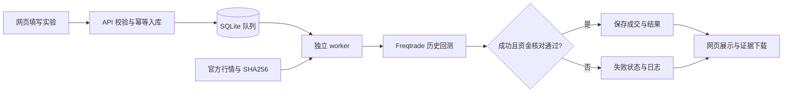

# QuantPilot

面向课程答辩的量化策略研究平台。本目录为 **C 盘重建版本**：从幸存代码和开发记录恢复源码，重新安装环境、下载行情并生成演示实验。它不等同于原 D 盘的完整数据恢复。

**答辩入口：** [完整演示操作流程](docs/答辩演示操作流程.md)（12 分钟 / 5 分钟版本、两人分工、逐页按钮、备用方案） · [2026-10-23 验收记录](docs/defense-acceptance-20261023.md)。本机已准备环境时双击 `launch.cmd`，无需再次安装。离线报告保存在 `artifacts/defense-pack-20261023`。

## 当前范围

- 研究规格确认、历史回测、实验报告、同条件比较、诊断、发布审核、虚拟资金模拟和历史回放。
- Binance 官方 BTC/USDT、ETH/USDT 小时 K 线；重建快照覆盖 2023-12-01 至 2025-10-01，每个品种 16,080 根。少量幸存的早期文件保留，原运行数据库未恢复。
- SMA12/SMA48 规则基线，与 FreqAI + LightGBM 的六小时收益回归策略；两者固定 5% 止损，未按收益搜索参数。
- 每次模型使用此前 90 天数据，30 天重训一次；拟合前剔除标签截止时间超过训练时点的样本，预处理只拟合训练数据。
- 开发区间为 2025Q2，验证区间为 2025Q3；最终测试 2025Q4 本周没有下载或运行。
- 可选的大模型研究助手、公开多交易所数据、新闻证据、独立 PPO 五种子研究及默认关闭的实盘控制模块；正常历史研究不需要交易账户或 API 密钥。
- 原始数据库、模型、密钥和完整 Git 历史没有恢复；当前新结果必须标注为重新生成。

## Windows 快速开始

项目当前位于 `C:\Users\20705\QuantPilot-Restored`，需要 Python 3.13、Node 22、uv。幸存的原 C 盘目录与恢复证据保留不动。

```powershell
cd C:\Users\20705\QuantPilot-Restored
.\setup.ps1
.\start.ps1
```

打开 http://127.0.0.1:8765 。当前电脑已准备依赖与行情时，只需运行 `start.ps1`。

```powershell
.\stop.ps1
```

启动脚本使用隐藏后台进程，运行日志在 `runtime/`。关闭网页不会自动停止服务。停止服务会中止尚在执行的实验并标记失败，已完成实验保留。不要同时手动启动第二个 worker。

开发调试可在两个终端分别运行：

```powershell
.venv\Scripts\python.exe -m quantpilot.worker
.venv\Scripts\python.exe -m uvicorn quantpilot.api:app --host 127.0.0.1 --port 8765
```

前端在 `apps/web` 使用 `npm.cmd run dev`，其 API 代理指向本地 8765；生产构建由 FastAPI 同源提供。

## 业务与技术边界

- FastAPI 校验参数并存入 SQLite；单独 worker 原子领取任务。刷新网页不会丢失任务。
- 同一个 Idempotency-Key 重试返回同一个任务，不创建重复实验。
- 每次执行复制行情和策略快照，校验行情哈希；保存生效配置、命令、引擎版本、原始 ZIP 和转换后结果。
- 非零退出码、超时、缺失行情、资金核对失败都标记为失败，不显示伪造结果。
- 本地回测仍需要访问 Binance 公共 market 元数据接口；历史结果浏览与下载无需交易所连接。
- 使用系统 HTTP(S) 代理环境时，CCXT 显式采用 aiohttp_trust_env；没有代理时直连。
- 只绑定 127.0.0.1，不提供公网部署或多用户访问能力。

## 结果解释

默认手续费为每边 0.1%，初始资金 10,000 USDT，单笔名义投入 1,000 USDT，同时最多一个交易品种一笔持仓。费率可在表单调整。

资金图是**已实现余额**，不是包含浮动盈亏的逐时净值。回撤采用 Freqtrade 已平仓账户回撤。换手定义为进出场名义金额总和除以初始资金。胜率在零成交时未定义，不显示为 0%。

成交遵循 Freqtrade 的 OHLC 回测假设；不声称完整模拟滑点、盘口或市场冲击。开发区间已经用于调试，不能充当最终未见测试集。基线是否盈利与软件链路是否正确是两件独立事项。

数据源与官方校验和 URL 保存于 `data/manifests/binance-week2.json`（旧版本为 `binance-2025q1.json`），含获取时间、时区、缺失值检查、每个文件 SHA256。Binance 2025 年后微秒时间戳转换为毫秒后统一转 UTC。原始数据重新分发前需核对源站使用条件，项目不将下载数据加入 Git。

模型预测是收益估计，不是上涨概率。历史拟合时点采用理想化截止时刻，实际训练耗时单独记录，未模拟计算延迟。后处理费用压力测试固定原成交路径，不是重新撮合。

## 验证

```powershell
.venv\Scripts\python.exe -m pytest -q
cd apps\web
npm.cmd run build
```

单元测试中的合成行情/交易只用于验证程序行为，不构成收益证据。旧验收文档属于历史记录，不能证明当前重建版本已经通过验收。运行专项检查：

```powershell
.venv\Scripts\python.exe -m quantpilot.diagnostics <已完成实验ID> --signals 20
```

专项检查在新目录内执行，不覆盖训练缓存或原结果。抽查通过只适用于已检查的信号；任何标记原样展示，不能把命令 exit 0 当成无泄漏证明。

## 项目文档

- [C 盘恢复与启动](docs/C盘恢复与启动.md)：当前路径、环境重建、数据来源和恢复边界。
- [恢复计划](docs/restoration-plan.md)：本次重建的实施与验收范围。
- [业务逻辑与操作说明](docs/业务逻辑与操作说明.md)：从第一次使用开始，解释各页面职责、新闻与 AI 的作用，以及研究、审核、模拟和实盘之间的关系。
- [第一周验收](docs/acceptance-week1.md)：真实结果、测试证据与未完成项。
- [第二周验收](docs/acceptance-week2.md)：模型、固定研究协议、比较结果和专项检查限制。
- [五分钟演示](docs/demo-script.md)：业务讲解、页面操作与两人分工。
- [当前进度](docs/progress.md)：第二周接续入口。
- [五周路线图](docs/superpowers/plans/2026-10-08-quantpilot-roadmap.md)：至答辩的阶段安排。



## 开源归属

- [Freqtrade / FreqAI](https://github.com/freqtrade/freqtrade)：交易策略接口、回测与后续机器学习能力；当前固定 2026.9，保留上游 GPL-3.0 授权要求。
- [Binance public data](https://github.com/binance/binance-public-data)：历史行情与校验和。
- FastAPI、React、Vite 等第三方依赖沿用各自许可证。
- 本项目实现：研究配置、持久化任务、运行隔离与错误处理、数据溯源、结果转换和中文展示界面。

本地开发代码尚未对外发布；对外交付时一并提供依赖许可与相关源代码说明。

恢复版入口：[C 盘启动说明](docs/C盘恢复与启动.md) · [本次恢复验收](docs/restoration-acceptance.md)。

后续修复：[2026-10-23 FreqAI 前视诊断边界说明与复验](docs/freqai-lookahead-fix-20261023.md)。
