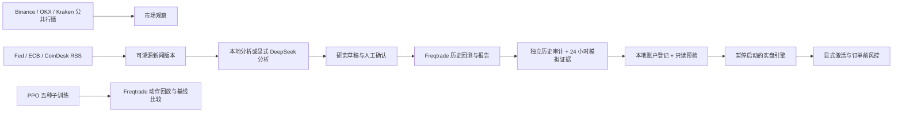

# QuantPilot MVP2 使用与答辩手册

工作目录：`D:\QuantPilot`。双击 `launch.cmd`，打开 <http://127.0.0.1:8765/>。保留全部 MVP1 研究、回测、审核、模拟、回放与报告功能。

第一次了解项目，先阅读 [业务逻辑与操作说明](业务逻辑与操作说明.md)，其中按页面解释操作步骤、输入输出与模块之间的真实关系。

## 四个新模块怎么连起来

多交易所页面用于公共市场观察。当前回测与模拟仍基于 Binance，实盘执行适配限定 Binance 现货与 SMA 策略；不能把行情接入数量解释成实盘支持数量。RL 研究不会自动生成发布资格，新闻或大模型文本不会直接下单。

## 建议的 8 分钟答辩路线

1. **研究总览（30 秒）**：说明平台解决的是“从假设到证据和受控执行”的业务过程，展示已保存的实验。
2. **多交易所（1 分钟）**：比较三家同一交易对的报价、来源时间与 K 线；刷新是持久化任务。过期行情和失败来源保留明确状态。
3. **新闻研究（1 分钟）**：选择 ECB 或 Fed 真实新闻，展示发布时间、首次观测时间、可知时间及原文。执行本地分析，再创建研究草稿。解释为什么 2026 年获取的新闻不能回填成 2025 年交易特征。
4. **研究与报告（1 分钟）**：打开已完成的新闻关联实验，展示草稿确认、真实引擎结果、交易记录与来源指纹。历史收益不归因于当代新闻。
5. **强化学习（2 分钟）**：打开已完成的 PPO 任务，展示五个种子、两个开发区间、SMA/持有基线和真实 Freqtrade 回放。展示负收益，说明模型训练成功不等于策略有效。训练可现场启动，但完整运行约 8 分钟，主讲优先使用已保存结果。
6. **实盘控制（1 分钟）**：展示默认未登记、未启用状态以及独立准入条件。说明暂停继续管理退出，停止引擎会停止本地止损管理。使用离线测试证据解释重复提交、响应未知、部分成交和恢复流程；不为演示临时开启真实账户。
7. **证据与边界（1 分钟）**：展示原始配置、哈希、引擎输出和验收记录，明确最终保留区间未运行、当前没有盈利结论。

## 已保存的可展示结果

- 新闻关联研究：`d1467bd7-ba39-5a05-a0a8-ffdb1cc5b653`。
- 关联实际回测：`74827205-66ba-4ede-8d6e-b45bcdca2995`，2025Q2，60 笔交易。新闻只是今天提出假设的背景。
- PPO：`rl-1db76077c9504e0995821a29263f3ee7`。五种子各 8192 步，14 行真实 Freqtrade 结果。两个区间 PPO 中位收益均为负，完整保留。
- 多交易所和新闻来源证据位于 `docs/evidence/mvp2/`；训练产物位于 `artifacts/rl/`。不要公开 `runtime/`、`.env` 或私有账户目录。

## 日常操作

公开行情和新闻刷新不需要账户密钥。新闻默认本地关键词分析；只有显式选择 DeepSeek 并提交分析才调用已在本机配置的模型。失败时展示错误，不伪造摘要或市场数据。CoinDesk 当前网络连接可能不可用，Fed/ECB 可用于完整新闻流程。

RL 使用独立环境 `runtime/rl-venv`，首次准备运行 `powershell -File scripts/setup-rl.ps1`。每次只运行一个训练任务，固定 CPU 两线程。取消会停止所拥有的子进程，保留真实日志和已经形成的证据。D 盘空间充足不代表物理内存增加。

实盘本地登记及 API 细节见 [实盘控制说明](mvp2-live-api.md)。本版本开发仅验证离线引擎与模拟账户夹具，未验证真实账户权限响应、测试网或实盘成交。密钥由用户在本机交互终端登记，页面只登录本地控制密码，不接收交易所密钥。账户尚未登记时，页面不可激活实盘。

关闭浏览器不会停止服务。执行 `stop.ps1` 会停止托管研究和模拟进程；存在未明确停止的实盘部署时，必须先在实盘控制中明确停止引擎。该操作不平仓，也不等于撤销交易所全部挂单。

## 两人团队如何分工讲解

- 第一位负责业务需求、新闻到实验的流程、界面演示与结果解释。
- 第二位负责数据时间边界、PPO 训练/回放差异、执行风控、测试与可复现性。

代码由 AI 协助完成仍需要团队能解释关键设计。答辩重点是来源可核验、状态真实、异常行为可解释以及功能之间的业务关系。

技术选型来源见 [开源项目说明](mvp2-open-source.md)，具体测试与网络结果见 [MVP2 验收记录](acceptance-mvp2.md)。
