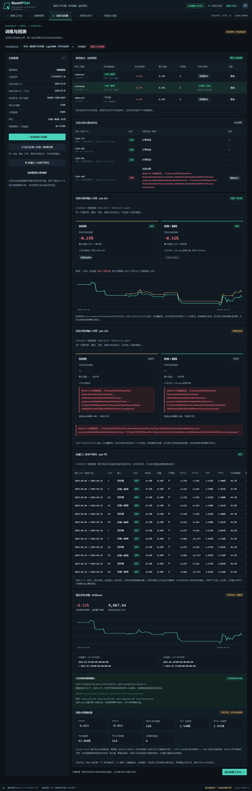

# 评估指标与多窗口、多种子研究

2026-11-17。本文对应个人策略终端 `/terminal/` 的评估扩展：补充风险调整收益与预测误差，并在受限窗口、种子下重新训练和评估。结果属于开发研究，不是最终盲测，也不是实盘收益记录。

## 页面操作

1. 在「训练与回测」选择已有规则、预测或 RL 配置，查看普通候选的评估区。所有类型可显示净值风险指标；只有预测回归模型有预测误差，PPO/规则对应项显示不适用。
2. 选择预测或 RL 策略，点击「多窗口 / 多种子研究」。填写两个不重叠的历史窗口，每个 14–31 天，限定在 `[2025-01-01, 2025-10-01)`；结束日期不包含。种子为 2–3 个不重复整数，范围 0–1000000。
3. 保持策略的品种、资金、费用和算法参数。新闻关闭则每个窗口/种子只算价格臂；新闻开启则每组算价格、价格＋新闻两臂。窗口覆盖表单中原先的研究日期，种子覆盖配置中的单个种子，其余参数保持一致。
4. 点击「提交真实研究」，在任务记录和研究表中查看逐行状态、收益、回撤、交易数、Sharpe/Sortino，以及适用的预测指标。两窗口 × 三种子 × 两臂最多 12 次训练，每行都重新训练，没有复制一行指标冒充多次实验。
5. 查看全部完成数、失败数和配对核验。任务终态表示调度已结束，仍需检查每行是否成功，部分完成不能视为完整对照。取消或失败会保留已有结果与错误，不用示例值补齐。

研究过程保存模型文件和证据，但**不把模型发布到可启动候选列表，也不替换运行中的账户**。若决定使用某一配置，另行发起普通训练或单组新闻对照，再手动选择候选启动模拟。新功能也不承担自动选择最优种子或在线升级模型的职责。



## 风险指标口径

输入是冻结评估产物中的逐小时盯市净值 `E_t`，小时收益为 `r_t = E_t / E_(t-1) - 1`，包含已有回测手续费与期末清算。新增模块核对声明的产物哈希，再计算指标，不改写旧模型、历史成交或净值文件。

| 项目 | 当前定义 |
| --- | --- |
| Sharpe | 小时平均收益 ÷ 小时收益样本标准差（`ddof=1`），乘 `sqrt(8760)` |
| Sortino | 小时平均收益 ÷ 下行均方根，乘 `sqrt(8760)`；下行均方根为 `sqrt(mean(min(r_t, 0)^2))` |
| 年化尺度 | 365 × 24 = **8760 小时**，不按股票市场 252 日年化 |
| 基准收益 | 无风险收益率 **0**，Sortino 最低目标收益 **0** |
| 最小样本 | 至少 **24 个小时收益**才计算比率；不足时返回未定义 |
| 分母为零 | 标准差或下行均方根不大于 `1e-12` 时，相应比率未定义，页面显示「—」，不显示无穷大或伪造 0 |
| Sortino 分母样本 | 对**全部小时**取均值；非负收益贡献 0，不仅对亏损小时取平均 |
| 时间序列 | 必须为有序、唯一、连续小时；其他缺口拒绝计算 |

旧评估器在评估开始保存初始资金，然后从下一根成交 K 线的收盘开始记录净值，导致首个时间间隔是 2 小时。第一小时没有持仓或成交，因此新指标计算层在该小时补入**等于初始资金**的净值点，也就是一个 0 收益小时。仅识别这一种确定的首小时缺口；任意其他缺口不会补值。原产物不变，补齐状态记录为 `initial_flat_hour_reconstructed`，避免把两小时变化当成一小时、或少算分母样本。

本次每行评估只有 5 天，即 120 个小时收益。`sqrt(8760)` 是统一的描述性缩放，不能把五天观测解释成一年已经实现的稳定表现；小时收益可能相关，样本长度和少量交易都影响比率稳定性。

## 预测误差口径

仅对 LightGBM 的收益回归输出计算，目标是 `close[t+h] / close[t] - 1`。时戳为 K 线开盘，预测在该 K 线收盘后可用，标签还需等待 `h` 小时。

| 指标 | 定义与单位 |
| --- | --- |
| MAE | `mean(abs(预测收益 - 实际收益))`；底层为收益小数，本报告乘 100 显示收益**百分点** |
| RMSE | `sqrt(mean((预测收益 - 实际收益)^2))`；同样为收益百分点，不是相对百分比误差 |
| 方向准确率 | `sign(预测收益) == sign(实际收益)` 的比例；正、负、零分别为三类 |
| 可用标签 | 只保留标签收盘时间不晚于该评估段结束边界的预测；未来尚未到期的标签排除 |
| 无回归输出 | PPO 和规则策略没有连续收益预测值，不计算 MAE/RMSE/方向准确率 |

本次 LightGBM 的预测期限为 6 小时，每行 120 条评估决策中最后 **6 条标签未在评估段内到期而排除**，实际误差样本为 **114**。预测误差、方向准确率和交易收益回答不同问题；更高方向准确率不代表按当前阈值和费用执行后收益更高。

## 本次真实研究协议

两任务均使用 Binance 现货 1h、10,000 USDT 初始虚拟资金、单次 1,000 USDT、单边手续费 0.1%、5% 闭合线止损，随机种子 `7, 42, 99`。每个窗口先训练、后评估，预热数据不计入评估。

| 窗口 | 研究区间（UTC，结束不含） | 训练区间 | 评估区间 |
| --- | --- | --- | --- |
| W1 | 2025-01-01 → 2025-01-15 | 2025-01-01 → 2025-01-10 | 2025-01-10 → 2025-01-15 |
| W2 | 2025-01-15 → 2025-01-29 | 2025-01-15 → 2025-01-24 | 2025-01-24 → 2025-01-29 |

- ETH/USDT：LightGBM、6h 预测期限、0.3% 入场阈值，包含价格和价格＋新闻两臂，共 12 行。
- BTC/USDT：PPO、每次 2048 步，仅价格输入，共 6 行。此任务检查种子和时间窗口变化，不是 PPO 新闻开关对照。
- 当前研究窗口不重叠，但因子预热可使用窗口前已知历史。同一窗口的种子复用同一行情，不能视为多个独立市场样本。
- 2025 Q4 保留区间未进入本轮训练或评估。

## 真实任务与结果

<!-- REAL_RESULTS_START -->
实际运行日期：2026-11-17。ETH 任务 `tjob-717812c689a44098b8dced8d678f4f72` 完成 **12/12**；BTC 任务 `tjob-44179293ecc4498581919f6641500f78` 完成 **6/6**，均无失败行。ETH 六组同窗口、同种子的价格/新闻配对行情哈希核验全部通过；BTC 只有一个输入臂，所以不适用新闻配对核验。两个任务均未发布可启动候选。

收益与最大回撤按百分数展示，Sharpe/Sortino 无量纲；MAE/RMSE 按收益百分点展示，方向准确率为百分比。以下保留全部窗口和种子。

### ETH / LightGBM：价格与新闻两臂

| 窗口 | seed | 输入 | 净收益 % | 最大回撤 % | 交易数 | Sharpe | Sortino | MAE（百分点） | RMSE（百分点） | 方向准确率 % |
| --- | ---: | --- | ---: | ---: | ---: | ---: | ---: | ---: | ---: | ---: |
| W1 | 7 | 仅价格 | -0.193782 | 0.535594 | 8 | -4.229131 | -5.492229 | 1.515727 | 1.900356 | 44.7368 |
| W1 | 7 | 价格＋新闻 | -0.324613 | 0.589872 | 8 | -6.622645 | -8.452804 | 1.539659 | 1.920529 | 43.8596 |
| W1 | 42 | 仅价格 | -0.193782 | 0.535594 | 8 | -4.229131 | -5.492229 | 1.515727 | 1.900356 | 44.7368 |
| W1 | 42 | 价格＋新闻 | -0.324613 | 0.589872 | 8 | -6.622645 | -8.452804 | 1.539659 | 1.920529 | 43.8596 |
| W1 | 99 | 仅价格 | -0.193782 | 0.535594 | 8 | -4.229131 | -5.492229 | 1.515727 | 1.900356 | 44.7368 |
| W1 | 99 | 价格＋新闻 | -0.324613 | 0.589872 | 8 | -6.622645 | -8.452804 | 1.539659 | 1.920529 | 43.8596 |
| W2 | 7 | 仅价格 | -0.521171 | 0.952909 | 9 | -6.875433 | -9.618530 | 1.574675 | 2.042178 | 46.4912 |
| W2 | 7 | 价格＋新闻 | -0.649958 | 0.937907 | 2 | -9.056423 | -11.577210 | 1.961736 | 2.557918 | 53.5088 |
| W2 | 42 | 仅价格 | -0.521171 | 0.952909 | 9 | -6.875433 | -9.618530 | 1.574675 | 2.042178 | 46.4912 |
| W2 | 42 | 价格＋新闻 | -0.649958 | 0.937907 | 2 | -9.056423 | -11.577210 | 1.961736 | 2.557918 | 53.5088 |
| W2 | 99 | 仅价格 | -0.521171 | 0.952909 | 9 | -6.875433 | -9.618530 | 1.574675 | 2.042178 | 46.4912 |
| W2 | 99 | 价格＋新闻 | -0.649958 | 0.937907 | 2 | -9.056423 | -11.577210 | 1.961736 | 2.557918 | 53.5088 |

三个种子在各自窗口/输入组合下的全部指标完全相同，与本次确定性 LightGBM 参数一致。W1 新闻臂的收益、回撤和预测误差均比价格臂更差；W2 新闻臂方向准确率较高、最大回撤略低，但净收益和预测误差仍更差。不能把方向准确率提升等同于盈利改善。

### BTC / PPO：价格输入的多种子结果

| 窗口 | seed | 输入 | 净收益 % | 最大回撤 % | 交易数 | Sharpe | Sortino |
| --- | ---: | --- | ---: | ---: | ---: | ---: | ---: |
| W1 | 7 | 仅价格 | +0.344902 | 0.434238 | 15 | 6.833644 | 12.597461 |
| W1 | 42 | 仅价格 | -0.386980 | 0.610087 | 11 | -9.363763 | -11.792590 |
| W1 | 99 | 仅价格 | -0.054759 | 0.353469 | 5 | -1.314166 | -1.965148 |
| W2 | 7 | 仅价格 | -0.236077 | 0.236077 | 3 | -13.849987 | -14.248985 |
| W2 | 42 | 仅价格 | -0.263489 | 0.385465 | 4 | -9.562224 | -11.383439 |
| W2 | 99 | 仅价格 | -0.040388 | 0.204614 | 3 | -1.966597 | -2.764122 |

PPO 输出离散交易动作，所以本表不填 MAE/RMSE 或方向准确率，也不以 0 冒充这些指标。

### 逐窗口种子汇总

下表只对同一窗口/算法/输入组合的三次净收益做算术汇总，不合并资金曲线，不把两个窗口接成连续运行结果，也不对年化比率做跨窗口平均。

| 算法 / 品种 | 窗口 | 输入 | 运行数 | 平均净收益 % | 最低净收益 % | 最高净收益 % |
| --- | --- | --- | ---: | ---: | ---: | ---: |
| LightGBM / ETH | W1 | 仅价格 | 3 | -0.193782 | -0.193782 | -0.193782 |
| LightGBM / ETH | W1 | 价格＋新闻 | 3 | -0.324613 | -0.324613 | -0.324613 |
| LightGBM / ETH | W2 | 仅价格 | 3 | -0.521171 | -0.521171 | -0.521171 |
| LightGBM / ETH | W2 | 价格＋新闻 | 3 | -0.649958 | -0.649958 | -0.649958 |
| PPO / BTC | W1 | 仅价格 | 3 | -0.032279 | -0.386980 | +0.344902 |
| PPO / BTC | W2 | 仅价格 | 3 | -0.179985 | -0.263489 | -0.040388 |

当前页面整体摘要对全部已完成行计算平均/最小/最大净收益，ETH 每臂含两个窗口各三个相同种子的重复结果；这种平均只便于浏览任务，不提供独立样本统计显著性。本报告保留逐窗口表，以免隐藏时间段差异。
<!-- REAL_RESULTS_END -->

## 可复查的来源与限制

本机任务目录为 `artifacts/terminal/<任务ID>/`。`comparison.json` 保存全部窗口、种子、逐行指标、错误、配对检查和摘要；每个 `window-N/seed-S-输入类型/` 保存冻结行情、模型、配置、评估净值和决策证据。研究生成的内部模型 ID 用于追溯文件，不等于已发布的可启动候选。数据与模型不上传 GitHub，仓库只记录代码、方法、结果汇总与页面截图。

新闻仍按 UTC 00/06/12/18 各一个 15 分钟 GDELT 批次抽样；使用四列标题规则计数，非全量新闻、非语义情绪模型。历史采用归档 +1h 的可用性假设，当前模拟另受真实接收/解析时刻约束。见[新闻方法说明](news-user-guide.md)。

回测包含配置手续费，但未完整模拟滑点、盘口深度、队列、市场冲击和交易所最小数量约束。结果来自短样本开发窗口；窗口变化、种子变化、开发期间重复观察以及同一行情上的重复训练，均不能替代独立最终测试。

LightGBM 当前使用确定性配置且未开启随机行/列采样，多种子可能得到相同权重与指标。这证明当前配置对种子不敏感的重复运行行为，不构成三个独立统计证据。报告保留每个种子，不用重复结果夸大样本量。PPO 则保留全部种子的变化，不只挑选最优收益。

## 实现与验证入口

- [风险和预测指标实现](../../../quantpilot/terminal_metrics.py)
- [多窗口研究调度实现](../../../quantpilot/terminal_robustness.py)
- [指标固定测试](../../../tests/test_terminal_metrics.py)
- [研究任务固定测试](../../../tests/test_terminal_robustness.py)

```powershell
.\.venv\Scripts\python.exe -m pytest tests/test_terminal_metrics.py tests/test_terminal_robustness.py -q
node --check apps/terminal/app.js
```

2026-11-17 本轮验证：主环境完整测试 **293 passed、2 skipped**（主环境未安装 Gymnasium），1 条已有 Starlette 弃用警告；RL 隔离环境相关测试 **6 passed**；`node --check apps/terminal/app.js` 通过。真实研究完成 **18/18**，结果见上表。本机默认 8765 端口当时无法绑定，页面与任务验收使用临时端口 **56854**；默认部署入口仍为 8765。这些是现有开发环境的验证记录，不代表已在空白电脑上重新安装验证。

固定测试验证计算和任务行为。完整 V1 的其余未完成能力仍以[验收清单](acceptance.md)为准，不因新增指标而自动变成已完成。
