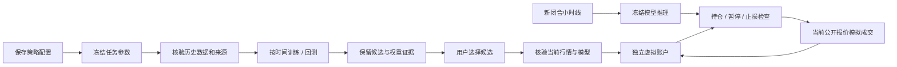

# 个人策略终端：真实数据主流程

入口：<http://127.0.0.1:8765/terminal/>。原型 <http://127.0.0.1:8770/> 仍是交互样稿；旧研究工作区 <http://127.0.0.1:8765/> 继续保留。

## 启动

在 `C:\Users\20705\QuantPilot-Restored` 执行 `start.ps1`；已有环境无需重新 setup。执行 `stop.ps1` 停止服务。新页面不需要单独启动 Node；FastAPI 直接提供 `apps/terminal`。

浏览器关闭后，本机服务继续训练和模拟；电脑休眠、断网、服务退出时无法继续执行。再次启动服务会保留策略、候选、账户和历史；被中断的训练保留失败原因，重新提交会创建新任务。运行中的模拟实例按恢复后的最新闭合 K 线继续，不补成交停机期间错过的信号。

## 一次完整操作

1. 进入「策略管理」，点击「新建策略实例」。选择规则、RL 或预测模型，填写名称、品种、历史日期、虚拟资金、单次开仓金额与参数。交易品种来自 Binance 公开现货目录；新品种可能没有所选历史，缺少数据时任务会失败并显示原因。
2. 保存后进入「训练与回测」，点击「启动训练与回测」。页面显示服务器真实阶段与错误，可取消任务。数据校验、训练和评价完成后才出现候选，不以倒计时模拟成功。
3. 查看候选的净收益、回撤、交易数、净值和证据。规则策略保存规则配置；预测策略保存 LightGBM 权重；RL 保存真实 PPO 权重与训练时归一化参数。负收益也可选择，软件不会把盈利作为可运行的前提。
4. 点击候选的选用按钮，再进入「策略工作台」启动模拟。后端核验候选归属、配置、产物与当前输入，初始化独立虚拟资金，并以已闭合小时线做第一次真实推理。没有买入信号时空仓是正常状态。
5. 在工作台查看当前行情、模型决策、虚拟持仓、订单与账户净值。后台每 30 秒检查一次，只有新闭合的 1h K 线触发新的模型决策；同一根线不会因为刷新或重复点击反复下单。
6. 「暂停新开仓」仍允许原持仓卖出和闭合线止损；「恢复」重新允许开仓。「平仓」按当前公开卖价模拟卖出。「停止」可等待原持仓按策略退出，或明确选择平仓并停止；已停止实例成为历史，重新启动创建新账户。
7. 新建另一个策略重复上述流程。最多四个同时活动的模拟实例，每个资金、持仓与模型引用独立。切换候选不会偷偷替换已经运行的实例；本轮升级操作为先停止旧实例，再选择候选启动新实例。

## 业务对象与数据流

保存策略不会自动训练；训练成功不会自动选模型；选模型不会自动开账户。账户只有模拟账本，没有交易所账户授权，也不向交易所发订单。

「信号 K 线截止」是模型输入可用的闭合时点；「本次推理 / 记录」是本机实际产生决策的时间。模型现在基于此前闭合线推理，不表示它在那根线的开盘时已经可用。已有任何模拟账户历史的策略不允许原地改品种和参数，使用「复制配置为新策略」。

## 本轮计算口径

| 环节 | 当前实现 |
|---|---|
| 市场 | Binance 现货 `BASE/USDT`，固定 1h，真实公开 ticker 和闭合 OHLCV |
| 历史 | 2025-01-01 至 2025-10-01 之间，结束日不含；至少 14 天；2025 Q4 保留 |
| 数据来源 | 原验证快照核验 SHA256；其余品种下载 Binance 官方月度 ZIP + CHECKSUM |
| 时间划分 | 研究窗口按时间约 70% 训练 / 30% 评价；预热不计入评价 |
| 预测策略 | 六个因果价格特征，未来收益回归；跨拟合截止时点的标签剔除 |
| RL | CPU PPO，2048 或 8192 步，单次指定种子；不是五种子统计结论 |
| 回测 | `local_paper_v1`，闭合线决策、下一根开盘成交；双方手续费，单持仓，期末清算 |
| 当前模拟 | 闭合线决策后，以观察到的公开 ask 买入、bid 卖出；实际成交时间与行情时间都记录 |
| 止损 | 闭合线触发；不是盘中触价立即止损，也不能保证损失不超过阈值 |
| 净值 | 虚拟现金 + 持仓按最新价估值；实际实现盈亏扣除开平仓手续费 |
| 交易约束 | 允许小数数量；未模拟盘口深度、队列、冲击、最小订单量和交易所数量步长 |

历史回测的 next-open 与当前模拟的观察报价有时点差异，费用口径一致，结果不能直接等同实盘表现。`local_paper_v1` 与原 Freqtrade/FreqAI 是不同执行器，不混接指标，也不把当前模型称为 Freqtrade dry-run。

开发窗口已经用于调试，不能作为未见最终测试。训练成功只证明链路可用，不证明策略有收益优势。

## 故障与记录

- 报价/闭合线过期、缺失或网络失败：展示故障，阻断新的模拟成交；不填充示例价格。
- 权重、配置、数据或运行兼容性不符：候选不可启动，已运行实例进入受阻状态；恢复有效环境或重新训练候选。
- 任务失败：保留真实错误与日志；修改配置后重新提交。新上市币在 2025 年没有足够历史时，换用有历史的币或缩短至有数据区间。
- 本机数据库：`data/terminal.sqlite3`；任务与冻结产物：`artifacts/terminal/`；市场缓存：`runtime/terminal-market/`。数据库与产物配套备份，代码进 Git，下载数据不进 Git。

## 后续范围

新闻页可展示旧后端已有证据，但本轮模型尚未接新闻事件因子 C；新终端明确禁用新闻训练开关。DeepSeek 助手、自动研究、运行中模型升级、更多周期和交易所、实盘账户连接继续按后续计划实施。当前闭环不需要任何密钥。

Binance 官方数据说明：<https://github.com/binance/binance-public-data>。每次任务的具体来源 URL、获取时间与校验值保存在对应 provenance 文件中。
