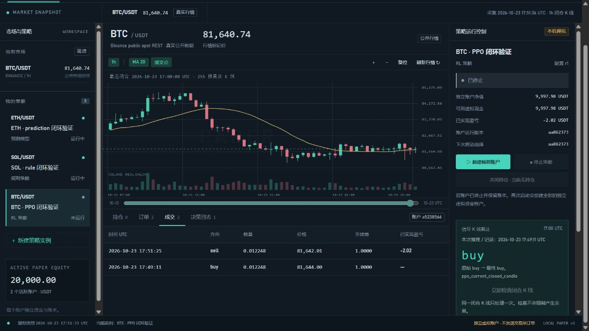
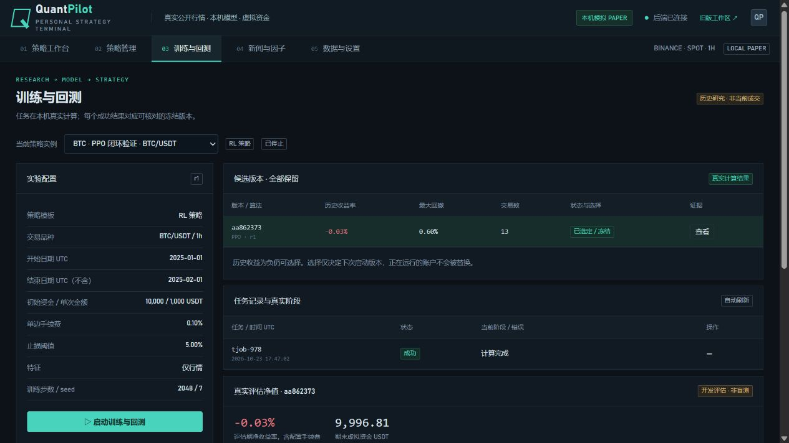

# 真实数据主流程验收记录

日期：2026-10-24（北京时间）；实际联网操作约 2026-10-23 17:44–17:54 UTC。分支：`feature/personal-terminal-workflow`，基于原型提交 `454f4c0`。完整 V1 尚未完成，本记录仅验收本次批准的主流程。

## 真实链路结果

所有任务均从正式 `/api/terminal` 服务提交，使用 Binance 官方行情，免费公开数据、本机 CPU，没有交易密钥或大模型调用。研究区间 2025-01-01 → 2025-02-01，拟合截止 01-22，评价 01-22 → 02-01；默认 10,000 USDT、每次 1,000 USDT、单边 0.1% 费用、5% 闭合线止损。品种不同，不将下表作为算法优劣对照。

| 类型 / 品种 | 任务 ID | 候选 ID | 评价净收益 | 完整交易数 |
|---|---|---|---:|---:|
| PPO / BTC | `tjob-97895c3523894a28b1992a8456438abe` | `model-aa8623735d594304bdd2cf8b771c163f` | -0.03186% | 13 |
| 规则 / SOL | `tjob-8c596cb36e1b4a7a805e1cc35ca1704d` | `model-130164fee70841248d2a5655949481f1` | -1.63448% | 4 |
| LightGBM / ETH | `tjob-3514acb8535e44c986933989ec4e8f78` | `model-4670a1e575ec4bf49f388a30287f9723` | +0.38021% | 19 |
| 规则 / SOL，再次提交 | `tjob-a98ca74ba3854b6cab44d2d1a40fecd0` | `model-192cb964afc24b8e8bda75804512d543` | -1.63448% | 4 |

重复 SOL 任务产生新候选并保留旧候选；选择新候选后，原账户仍引用 `model-130164...`，没有自动替换。

浏览器真实完成：新建 BTC PPO → 提交训练 → 等待服务器成功 → 查看候选 → 手动选择负收益版本 → 创建模拟账户 → 当前推理买入 → 暂停新开仓 → 刷新与服务重启 → 平仓并停止 → 检查两笔模拟成交及费用。

BTC 账户 `instance-a5238566cd0e4723a844f2ae201d124f`：17:49:11 UTC 以公开 ask 81,644.00 模拟买入；17:51:25 以公开 bid 81,642.01 模拟卖出。扣双边费用后余额 **9,997.97565026 USDT**，已实现盈亏 **-2.02434974 USDT**；账户已停止且空仓。不是实际交易所订单。

SOL 账户 `instance-39d6cb1165ee41599dea7576dfc563bd` 与 ETH 账户 `instance-bc343190b6ac4fe2b94934e09227ea25` 已分别启动、暂停、恢复。检查时无入场成交，各有 10,000 USDT；保持实际空仓状态，没有为展示制造交易。

## 数据、状态与失败路径

- 公开目录实际返回 506 个活动 USDT 现货品种（采集时点数量，后续会变化）。公开请求 256 根 1h K 线，过滤当前未闭合线后得到 255 根；当前报价时间、采集时间、输入闭合时间分别保留。
- BTC/ETH 复用既有历史快照并核验哈希；SOL 实际下载官方月度档案和 CHECKSUM。单月任务含预热共 816 行，UTC 连续小时检查通过。
- 训练/启动重复请求返回同一对象；同根已闭合线重复检查不增加订单；后台并发检查的单元测试验证只记一次决策和成交。
- 服务停止再启动后，三个账户的 ID、模型引用、现金、持仓、订单、最后决策和暂停状态一致。证据 `artifacts/terminal-api-verification-20261024/restart.json`。
- 浏览器刷新后重新读取同一服务器账户。行情时间过期、刷新失败和切换页后旧缓存不再标正常；报价早于输入闭合时点会阻断执行。
- 固定测试数据覆盖行情断流、缺时间戳、缺小时、未闭合线、哈希篡改、越界日期、暂停保留止损、停止期间并发开仓、候选兼容性、取消后迟到产物、编辑历史策略阻断。故障注入用于程序验收，不作为收益证据。
- 引擎规格审查与后端/数据交叉质量审查完成，发现的停止竞态、缓存错误状态、整点报价时序和历史策略编辑问题已修复并加回归。

## 验收清单映射

| 项目 | 本批状态 |
|---|---|
| F-01 | 主流程通过：品种可填写、训练自动准备真实数据；独立可管理下载页仍待后续 |
| F-02 | 草稿 revision、复制、配置冻结通过；产生账户后禁止原地修改，须复制 |
| F-03、F-05、F-06 | 实际规则回测、预测训练当前推理、负收益可运行及无效产物拒绝通过 |
| F-04 | 部分：实际 PPO、候选保留与手选通过；专门多种子/基线比较工作区未交付 |
| F-07 | 当前闭合线真实 PPO 推理和同线去重通过；多小时持续运行不在本次短时演练范围 |
| F-08 | 价格输入因果与闭合线测试通过；新闻时序尚未实现 |
| F-09、F-10 | 独立账户、暂停/恢复、停止与显式平仓通过；暂停时风控故障路径由自动测试验证 |
| F-11、F-12 | 尚未实现运行中升级；当前必须停止旧实例后启动新账户，不能当作原型 A/B 升级完成 |
| F-13～F-19 | 新闻页仅旧缓存只读；新闻模型、C 因子、对照与执行门控未实现 |
| F-20、F-21、F-22 | 图表/切换/刷新、数据新鲜度、重启/幂等账本和任务失败取消路径通过对应自动测试或演练 |
| F-23、F-24 | 自动研究、DeepSeek 助手未接入；保持后续范围 |

## 验证命令与本机证据

```powershell
.venv\Scripts\python.exe -m pytest -q -ra
runtime\rl-venv\Scripts\python.exe -m pytest -q tests/test_rl_env.py
C:\node\node.exe --check apps/terminal/app.js
git diff --check
```

最终主环境结果：**253 passed，1 skipped，1 warning，69.53 秒**。输出见 `artifacts/terminal-api-verification-20261024/pytest.txt`；跳过原因是主环境没有 gymnasium，对应旧 RL 环境测试在隔离环境另跑 **4 项通过，2.15 秒**。warning 为既有 Starlette/httpx 弃用提示。JS 语法与 diff 空白检查通过；浏览器验收结束时捕获的 warning/error 日志为空。

正式任务产物位于 `artifacts/terminal/<任务ID>/`，模型目录含权重、有效配置、来源证明、数据快照、文件/代码哈希、依赖版本、训练审计及回测报告。`artifacts/terminal-api-verification-20261024/` 保留真实 API 检查脚本、请求产生的 ID、状态与最终证据。此前 `terminal-engine-probe-20261024` 是开发探针，代码补强后已过期，不能用其旧候选启动当前服务。





本轮没有真实资金交易、分钟级策略、盘口撮合或生产级持续运行承诺。`local_paper_v1` 回测和当前模拟的撮合时点不同，详见[操作说明](live-workflow-guide.md)。2025 Q4 未下载/训练/评价；没有推断策略具备未来盈利能力。
