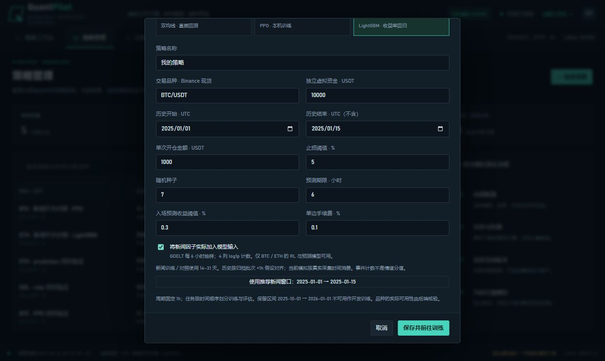
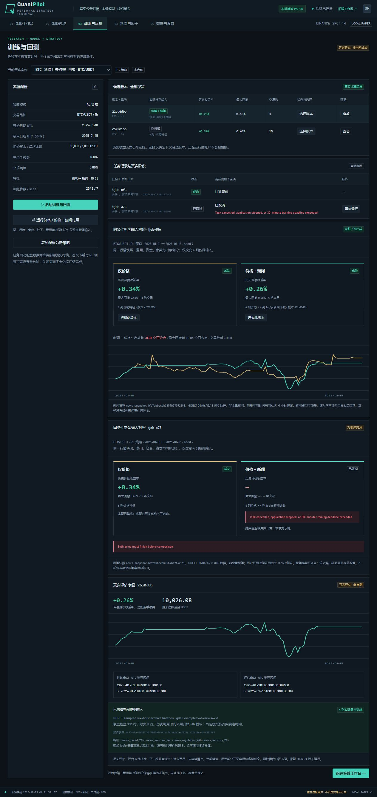
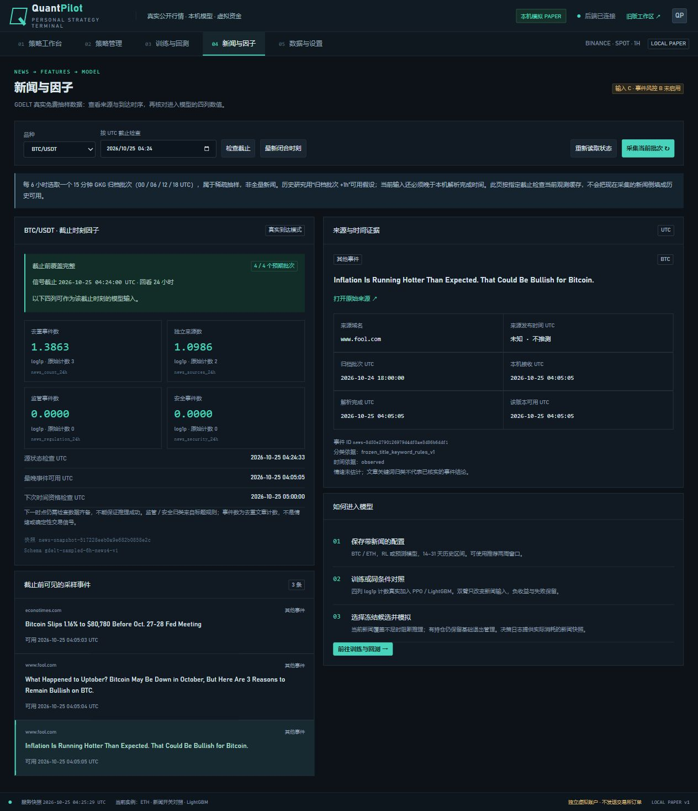
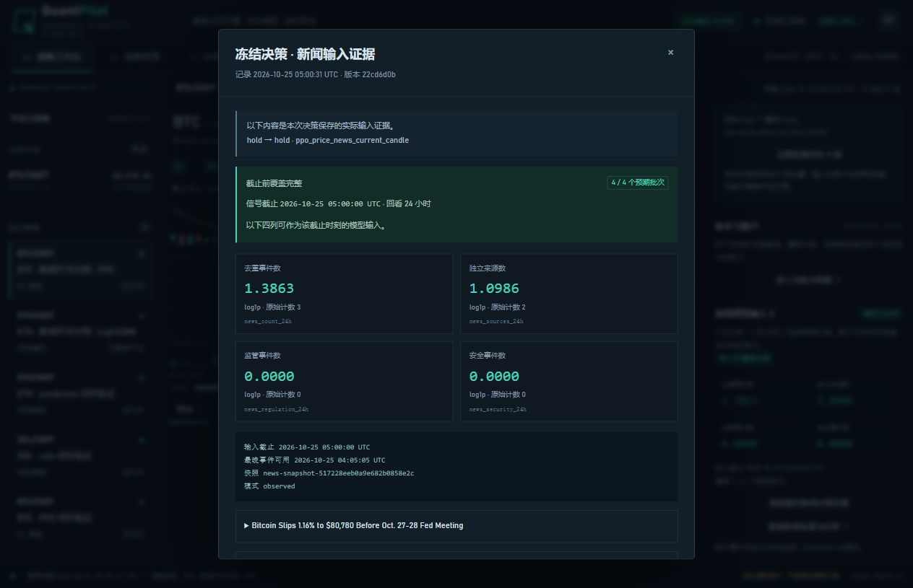
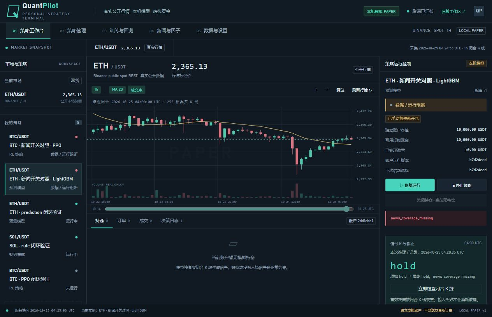

# 新闻模型与价格对照：操作说明

本文对应个人策略终端的新闻输入功能，入口为 [QuantPilot 个人策略工作台](http://127.0.0.1:8765/terminal/)。界面使用真实公开行情、GDELT 新闻采样和本机模型，账户资金为虚拟资金。本说明描述当前实现和操作方式；某次实验是否完成、是否可用，以该任务及候选的实际状态为准，不把说明中的步骤视作训练验证报告。

独立原型 `8770` 仍使用演示数据。进行下面的操作时，请使用 `8765/terminal/`，并保持本机后端服务运行。浏览器关闭不等于停止后端任务；电脑休眠、断网或服务退出会影响训练、采集和模拟。

## 1. 创建可用新闻输入的策略

1. 在「策略管理」点击「＋ 新建策略」，或在工作台点击「＋ 新建策略实例」。
2. 选择「RL 策略」或「预测模型」。RL 使用 PPO，预测模型使用 LightGBM；规则策略不能开启本批新闻输入。
3. 品种填写 `BTC/USDT` 或 `ETH/USDT`。新闻功能目前只支持这两个 Binance 现货品种，周期固定为 `1h`。
4. 填写名称、独立虚拟资金、单次开仓金额、手续费、止损及模型参数。单次开仓金额加手续费不能超过虚拟资金。
5. 勾选「将新闻因子实际加入模型输入」。
6. 点击「使用推荐新闻窗口：2025-01-01 → 2025-01-15」，或自行填写 **14–31 天**的区间。结束日期不含在区间内，所以推荐窗口正好是 14 天。所有日期按 UTC 计算；开始不得早于 `2025-01-01`，结束不得晚于 `2025-10-01`，`2025 Q4` 保留区间不可用于本批开发训练。
7. 点击「保存并前往训练」。保存配置只创建策略，不会立即训练或创建模拟账户。

新闻开关控制「启动训练与回测」这类单次任务的输入：关闭时只使用价格特征，打开时增加四列新闻特征。「运行价格 / 价格＋新闻对照」始终创建一组一关一开的配对实验，因此也能从满足品种、类型和日期要求的价格策略发起。

需要修改已有策略的日期或参数时，可在训练页点击「复制配置为新策略」，调整副本后保存；已有模拟账户历史的配置保持不变。

## 2. 运行价格与新闻的双臂对照

在「训练与回测」确认当前策略后，点击「⇄ 运行价格 / 价格＋新闻对照」。

这是一个后台任务，两侧依次计算。任务共享价格快照、历史区间、时间划分、模型参数、随机种子、资金、手续费及训练预算，比较项是额外的四列新闻输入。不要另建两个日期或参数不同的任务后，把它们当作同条件对照。

页面提供以下信息：

- 「任务记录与真实阶段」显示排队、数据准备、训练、评估及失败原因；采集期间可显示实际新闻批次数进度。
- 「同条件新闻输入对照」分别显示「仅价格」和「价格＋新闻」的状态、净收益率、最大回撤与交易数。
- 只有两侧完成、可比性检查通过且候选发布后，才显示完整可比较结果、同轴净值曲线和「新闻 − 价格」差值。
- 「收益差」与「最大回撤差」使用**百分点**；交易数差使用笔数。两条曲线对应同一时间轴与资金尺度，金色为仅价格，青绿色为价格＋新闻。

可以点击「取消任务」，但要等待后端返回取消状态。一侧成功、另一侧失败或取消时，已完成侧的指标可以保留为部分证据，整组仍显示未完成，不会发布可启动的半组候选。排除错误后点击「重新运行」，会创建新任务并保留原记录。

负收益、新闻侧表现更差或没有交易，都是可能出现的实际结果。该对照是有限区间的开发评估，不能证明新闻带来因果收益改善，也不证明未来盈利。

## 3. 选择候选，再启动当前行情模拟

1. 对照完成后，在任一侧点击「选择此版本」；也可在候选表中点击「选择版本」。可以选择仅价格或价格＋新闻候选，包括收益为负的候选。
2. 核对候选表的「实际模型输入」。仅价格模型为六列价格特征；新闻模型为六列价格加四列新闻，共十列。
3. 点击候选「证据」栏的「查看」，可检查真实任务保存的时间区间、输入列、训练信息、新闻快照、数据与产物哈希。评估区间和训练区间在下方净值结果中分别展示。
4. 点击「前往策略工作台」，核对「下次启动选择」，再点击「启动模拟运行」并确认。
5. 后端核验候选、当前价格与模型输入，建立独立虚拟账户。若首次新闻输入尚未到达合格截止时刻，可以建立等待账户；这不表示已成功推理或成交。
6. 观察账户状态、现金、净值、持仓、订单和决策日志。没有入场信号时可以持续空仓，系统不会为了展示而强制买入。

对照中选出的候选自带实际输入配置。即使原策略的新闻开关打开，也可以选择仅价格候选运行；反之亦然。工作台显示的账户版本及新闻状态以该账户冻结的候选为准。

同一策略同时只能有一个活动模拟账户。选择新候选不会替换正在运行的账户。要试另一个版本，先明确停止旧账户，再选择候选、创建新模拟账户。新账户使用新的独立虚拟资金，旧账本保留；这不是在原资金曲线上无缝升级模型。

历史评估采用闭合 K 线决策、下一根开盘价成交并计入配置手续费；当前模拟买入用公开 ask、卖出用 bid，缺少对应报价时退回最新成交价 last，账户净值按 last 盯市。两者撮合口径不同，不能把历史曲线当作当前实盘表现。

## 4. 查看新闻来源、覆盖与时间证据

打开「新闻与因子」，按以下顺序检查：

1. 选择 `BTC/USDT` 或 `ETH/USDT`。这个选择只改变新闻查看对象，不修改策略配置。
2. 点击「最新闭合时刻」检查当前观测缓存对应的最新小时截止。若需要核对某个已经发生的时刻，在「按 UTC 截止检查」中输入日期时间，再点击「检查截止」。这里输入的是 UTC，不是电脑的北京时间；北京时间比 UTC 快 8 小时。
3. 查看「信号截止」、回看 24 小时窗口和「已观测 / 预期批次」。展开缺失批次可以区分哪些档案尚未成功取得，或尚未在该截止前到达。
4. 查看四列模型输入、原始计数、源状态检查时间、最晚事件可用时间和新闻快照 ID。
5. 在「截止前可见的采样事件」中选择一条记录，核对来源域名、标题、品种、分类、归档批次、本机接收、解析完成及该版本可用时间；「打开原始来源」可访问外部文章链接。

「重新读取状态」只读后端已观测缓存，不等待新闻下载。独立后台采集器约每 60 秒检查一次；「采集当前批次」主动请求当前采样批次，短时间重复请求可能复用缓存。首次采集可能需要较长时间，页面会显示进行中，期间可以切换其他页面。

当前新闻查看页检查的是**当前观测缓存**。输入一个过去的截止时刻，不会下载或伪造那个时刻已知的新闻，也不会读取训练任务的历史包替代当前证据。某个训练候选的历史新闻来源应在其候选证据中查看。

| 页面状态 | 含义 | 操作 |
| --- | --- | --- |
| 截止前覆盖完整 | 该截止需要的采样批次齐备，四列数值可用 | 核对事件与数值，再查看对应模型状态 |
| 覆盖完整 · 零匹配事件 | 批次齐备，但该品种没有匹配文章 | 四列可以正常为 0；不代表全网无新闻 |
| 截止前覆盖不足 | 有批次未取得，或实际可用时间晚于截止 | 保持缺失，等待合格闭合时刻并重新检查 |
| 新闻来源故障 | 采集或解析存在来源错误 | 查看错误，恢复网络或来源后重新采集；不能用 0 替代 |

覆盖不足时，四列显示「—」，下方可能仍有已到达的部分事件；部分事件不等于完整模型输入。「下次时间资格检查」只是下一次时间检查点，不保证届时数据齐备或模型一定产生信号。

## 5. 四列新闻输入如何计算

每个信号截止时刻回看 24 小时，对截止前已可用的采样文章按文章键去重，并采用当时可见的版本。四个原始计数都转换为 `log1p(count)`，即 `ln(1 + count)`，再进入模型。

| 特征 | 原始计数含义 |
| --- | --- |
| `news_count_24h` | 该品种匹配的去重采样文章数量 |
| `news_sources_24h` | 这些文章的独立来源域名数量 |
| `news_regulation_24h` | 被标题关键词规则归为监管类的采样文章数量 |
| `news_security_24h` | 被标题关键词规则归为安全类的采样文章数量 |

数据来自 GDELT GKG 标题元数据。系统在 **UTC 00、06、12、18 点**固定选择一个 **15 分钟归档批次**；中间其余批次不在本轮采样范围内。因此“覆盖完整”指声明的采样计划完整，不能解释为完整收集了六小时、一天或全网的新闻。

品种匹配与事件分类使用冻结的标题关键词规则。这里的“事件数”是去重文章计数，不是已核实的独立现实事件数。来源文章可能有误、标题可能歧义或遗漏，四列也不是情绪分值；本功能没有调用 DeepSeek 做解读或交易判断。

历史研究和当前模拟分别采用以下时间规则：

- **历史训练 / 评估：**以「归档批次时间 +1 小时」作为该批历史记录的可用时间假设，另存真实下载与解析时间。这是明确声明的回溯研究假设，不是恢复了当年本机实际收到新闻的时间。
- **当前模拟：**取「本机解析完成时间」与「归档批次时间 +1 小时」中的较晚者作为可用时间，不能将刚采集的数据倒填到已经过去的决策截止。

例如本机在 10:05 UTC 才完成首次采集，这些输入不能用于 10:00 UTC 的已闭合信号。需要等到后续满足时间条件、且所需批次完整的闭合时刻；是否合格以覆盖检查为准。

## 6. 查看某次决策实际使用的新闻

在「策略工作台」右侧查看「新闻模型输入 C」，或进入下方「决策日志」点击「新闻输入证据」。这会打开该次决策保存的新闻快照证据，不用后续刷新的新闻改写过去记录。

重点核对：

- 信号 K 线截止与本次推理 / 记录时间：前者是闭合输入时点，后者是本机实际记录时间。
- 原始动作、最终动作及原因：最终动作还受账户暂停、恢复锁、已有持仓与基础止损状态影响。
- 输入是否有效、该 K 线是否已消费：输入缺失的记录不能当作成功模型预测；未消费的记录允许在数据齐备后重新检查同一根闭合线。
- 四列真实数值、覆盖状态、关联事件、最晚事件可用时间和快照 ID。

「立即检查闭合 K 线」只请求后端重新检查，不强制开仓。已消费的有效决策不会因刷新或重复点击而反复下单。

## 7. 冷启动等待与运行后故障恢复

这两种情况的操作不同，请以右侧状态说明为准。

| 情况 | 页面表现 | 后续操作 |
| --- | --- | --- |
| 首次启动，还没有过成功新闻推理 | 「首次等待 · 输入缺失」；账户可能显示「数据 / 运行阻断」 | 查看新闻覆盖、采集状态与截止时间。输入齐备后后端可自动就绪；如果主动暂停过，仍保持手动暂停 |
| 已成功推理，随后新闻输入故障或缺失 | 「新闻阻断 · 恢复需确认」 | 先恢复数据，核对来源与覆盖。仍缺失时点击恢复也不会绕过校验 |
| 上述故障已经恢复，但尚未确认 | 「覆盖恢复 · 待确认」；仍禁止新开仓 | 点击「确认新闻恢复」，后端重新核验当前行情、模型及新闻，全部通过后才解除恢复锁 |
| 用户主动点击「暂停新开仓」 | 「已暂停开仓」或仍显示更高优先级的数据阻断 | 数据正常后点击「恢复运行」；如同时存在新闻恢复锁，按钮显示「确认新闻恢复」。新闻自动恢复不会撤销用户主动暂停 |

人工恢复只解除当前允许恢复的状态，不会强制买入、重放错过的交易或清空历史。已有持仓保留基础价格止损检查；新闻输入故障时不能依赖缺失的新闻模型生成正常新信号。覆盖恢复但仍等待确认时，新买入继续被抑制，允许的退出管理仍保留。

如需结束本次实验，点击「停止策略」。有持仓时选择「等待当前持仓结束后停止」或「关闭模拟持仓，然后停止」，以服务端确认结果为准。等待止仓期间不能恢复新开仓；已停止账户的账本保留，再次启动会创建新账户。

## 8. 本批功能边界

本批实现的业务路径是：保存模型配置 → 获取声明范围内的价格与新闻采样 → 单次训练或新闻开关配对对照 → 人工选择冻结候选 → 当前公开行情下模拟运行 → 查阅决策输入与账本。实际验收状态见[新闻验证记录](news-verification.md)。

本批新闻模型输入仅支持 BTC/ETH 现货、1h 决策、14–31 天新闻研究窗口。新闻 **C** 是实际数值模型输入；额外的新闻事件风控 **B** 尚未启用。数据缺失阻断用于保证模型输入完整性，现有账户仍有基础价格止损和人为暂停控制。

本批不包含真实资金交易、全量新闻覆盖、情绪分析、自动选择盈利模型或在线替换运行账户。历史评价包含配置手续费，但没有完整模拟滑点、盘口冲击与实盘成交条件。实际对照结果可能变差，任何一组开发评估结果都不是收益保证。
