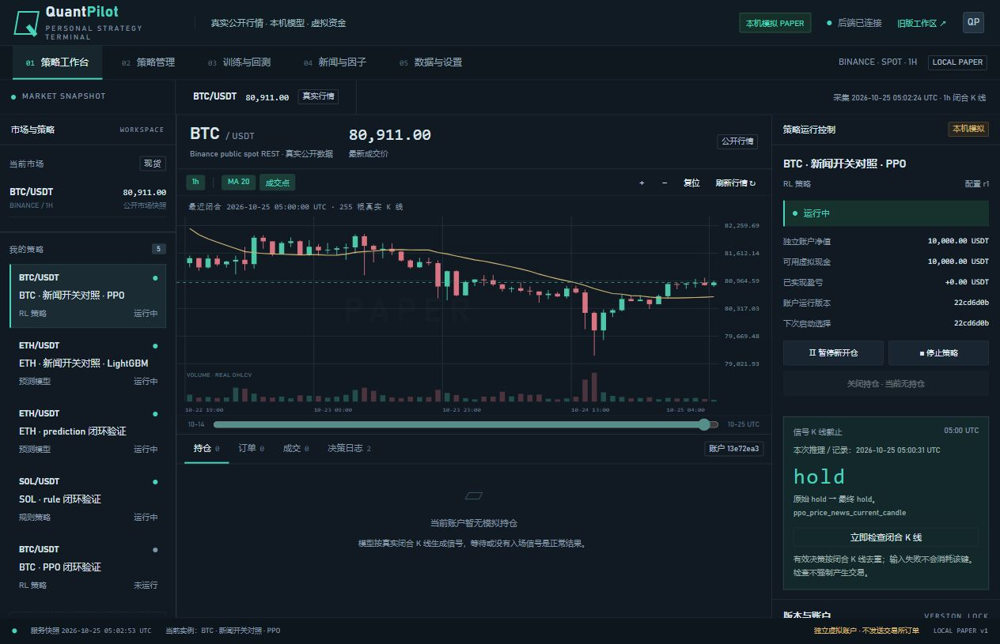
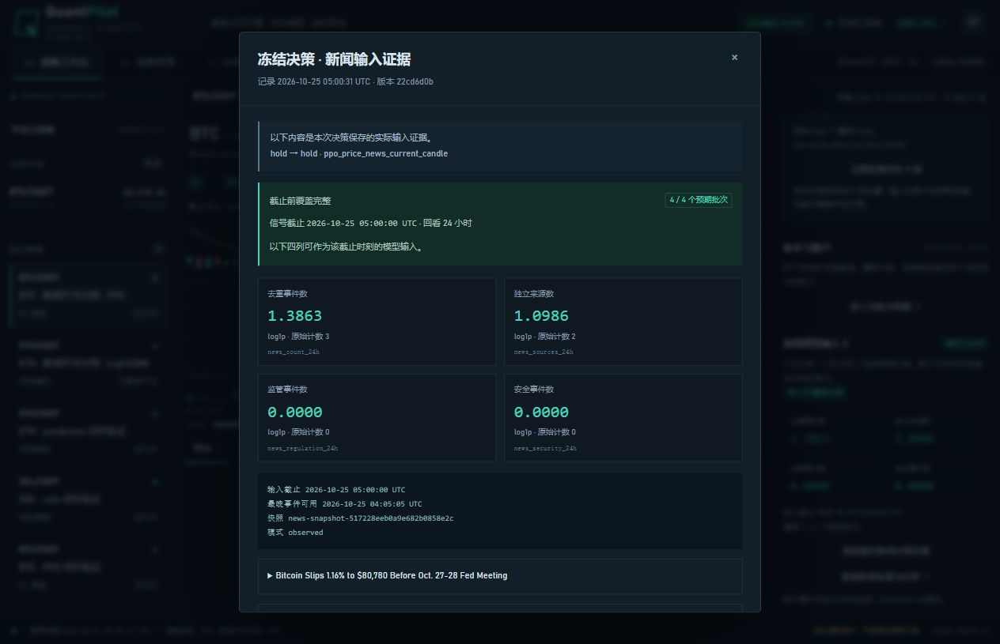
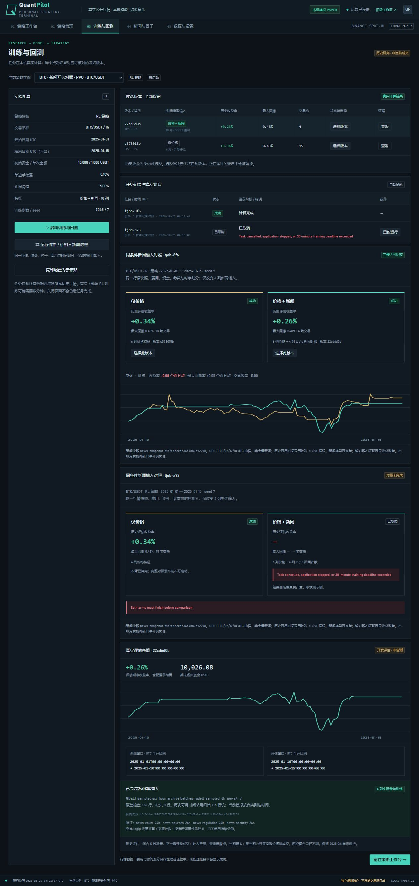
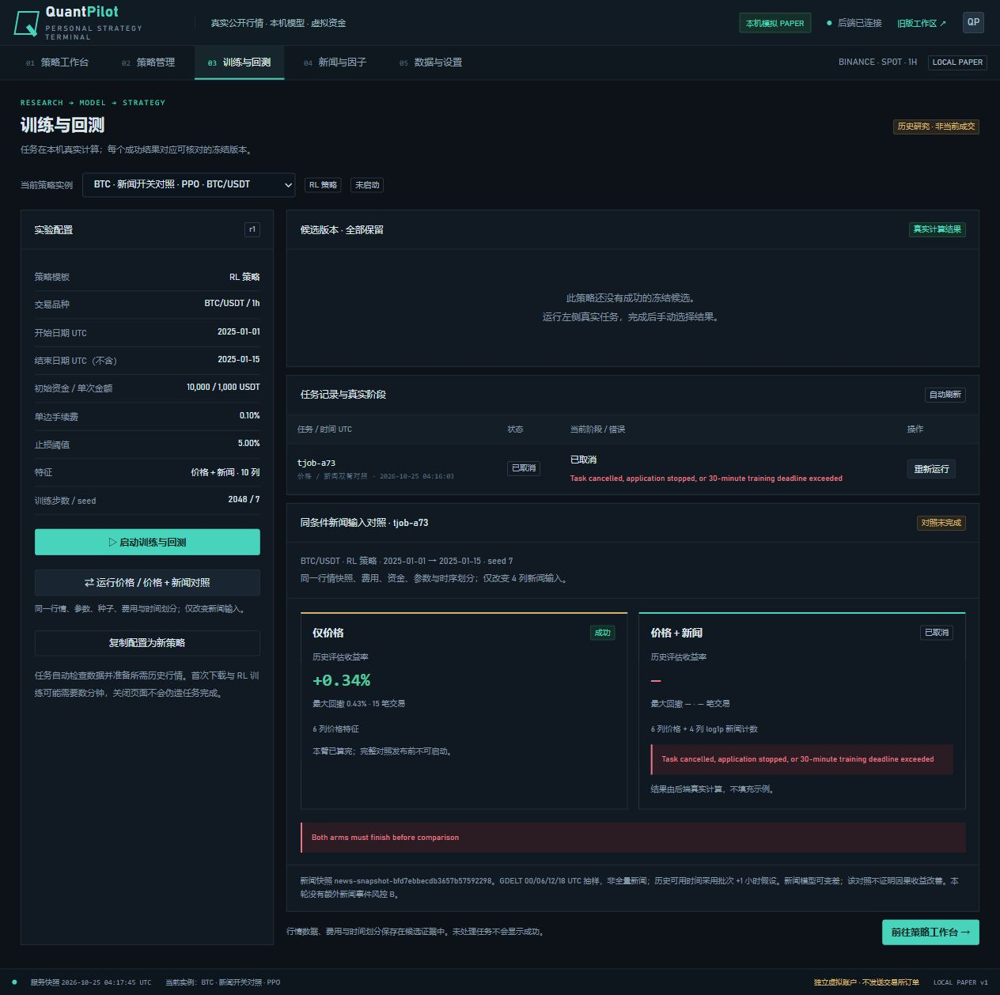

# 新闻事件模型阶段验证记录

2026-10-25，北京时间。分支 `feature/news-event-factors`，基于 `b56d8ba`。本记录针对新闻模型输入 C、同源对照及当前模拟；完整 V1 的升级、自动研究、助手和额外新闻风控 B 不在本批完成范围。

入口：<http://127.0.0.1:8765/terminal/>。操作方法见 [新闻模型使用说明](news-user-guide.md)。

## 真实数据与模型对照

正式浏览器提交两组任务，均为 Binance 现货 1h、2025-01-01 至 01-15 半开区间，训练 01-01 至 01-10、开发评估 01-10 至 01-15。两臂共享一份行情快照和协议：10,000 USDT 初始虚拟资金、1,000 USDT 开仓金额、单边 0.1% 费用、5% 闭合线止损、seed=7；PPO 均为 2048 步，LightGBM 期限 6h、入场阈值 0.3%。只改变新闻开关。

| 算法 / 品种 | 输入 | 净收益 | 最大回撤 | 完整交易数 | 候选 ID |
|---|---|---:|---:|---:|---|
| PPO / BTC | 仅价格 | +0.344902% | 0.434238% | 15 | `model-c578015b34424376a5af4c9aa0c5c57f` |
| PPO / BTC | 价格＋新闻 | +0.260814% | 0.484759% | 4 | `model-22cd6d0b25b44d67b81407c06012a654` |
| LightGBM / ETH | 仅价格 | −0.193782% | 0.535594% | 8 | `model-d806c43397204513853dd3ebca064457` |
| LightGBM / ETH | 价格＋新闻 | −0.324613% | 0.589872% | 8 | `model-b7d24eed5f3c4430b109f0793e7d6851` |

任务：BTC `tjob-8f6483a7ee8f401abd72ad64ba375427`，ETH `tjob-bb12a8ab3a4a4dcabb8d63f1a363531b`。新闻两臂都更差；这是功能和研究协议验证，不是盈利能力、新闻因果作用或算法优劣的证明。窗口只有两周、一个种子，2025 Q4 未用于本次训练/评估。

另从浏览器点击「启动训练与回测」，完成普通单次新闻任务 `tjob-66865b8f72f3419388908f599d90706d`，产出十列 LightGBM 候选 `model-41043ee2693142dfa77272b4b735f89c`。已校验模型包；同配置结果与新闻对照臂一致，ETH 当前账户的旧候选引用和暂停标记保持不变。该任务验证普通训练入口，不作为额外独立样本或新种子。证据：`artifacts/news-verification-20261025/single-training.json`。

真实新闻包来自 GDELT GKG 2.1：60 个固定批次、304,154,751 字节、74,080 行原始元数据，提取 81 条 BTC/ETH 相关标题观测（BTC 74，ETH 11，资产可重叠）。该包含窗口前 24 小时的新闻预热。历史快照 ID `news-snapshot-bfd7ebbecdb3657b57592298`；规范化内容摘要 `content_sha256` 为 `bfd7ebbecdb3657b57592298ebf1bafd2c62a2ec7525f1130a28eaadbf8672f5`，正式模型目录中 `news-snapshot.json` 文件字节 SHA256 为 `43adc3bee4e9ccd55540f325acf1b8cd88ac65cea75295b54b1a2566c02bc686`。两类摘要用途不同。

覆盖 60/60 仅表示 **UTC 00/06/12/18 各一个 15 分钟批次** 的采样网格完整，不代表一天全部 96 个批次或全量新闻。标题按 BTC/Bitcoin、ETH/Ethereum/Ether 关键词匹配；分类是固定关键词规则，可能误判或漏报，不是情绪模型。保留标题、来源、原始 URL、归档时刻、实际下载/解析时刻和文件哈希，不抓取文章全文。

## 新闻确实进入模型的证据

- 原价格模型为六列；两个新闻模型实际权重输入为十列。新增四列为 24h 文章数、来源数、监管文章数、安全文章数的 `log1p`。
- 每个新闻包保存 `feature-matrix.feather`、`news-feature-audit.json`、`news-snapshot.json`、训练审计、模型文件与代码/依赖/配置哈希。逐行重算 336 个小时的输入均匹配，覆盖缺失为零；事件可用时间均不晚于该行截止。
- BTC 文章数/来源数在 294 行非零；ETH 在 168 行非零。**两品种的监管、安全两列在本窗口全为零**，只验证了列保留和相应固定测试，不能声称这里学到了监管或攻击事件效应。
- ETH 保存的 LightGBM 对 `news_count_24h` 实际做了 3 次分裂，增益合计约 0.001095；其他三列未被树分裂使用。PPO 已核对真实十维观察、保存训练矩阵与仅训练窗口拟合的归一化器，未虚构因子重要性。
- 两臂行情文件哈希、时段、成本、资金、seed、训练预算一致。LightGBM 清除了拟合截止前仍未知的未来标签；不根据开发评估收益挑选 checkpoint。
- 两组对照的 4 个新候选、普通训练的 1 个新候选及此前 4 个旧候选均经模型校验；旧 `terminal_engine.py`、`terminal_features.py`、`terminal_rl.py` 字节保持不变。

只读产物审计：`artifacts/news-integration-engine-audit.json`。

## 时间含义与延迟检查

历史可用时间明确采用「归档时刻 +1 小时」假设，不把 2026 年下载记录伪称为 2025 年实际到达。当前运行采用两者较晚者：真实本机解析完成时间、归档时刻 +1 小时。聚合先按可用时刻过滤，再取该时刻最新的文章版本，并在 24h 窗口内按 URL 去重。重复归档观察保留，避免历史完整包和当前滚动缓存产生不同计数。

对同一实际新闻包额外延迟 1h、2h，按冻结采样口径重算可用性，分别有 56/336、112/336 行不再满足覆盖。系统会阻断，不能补零。该检查只量化可用性敏感度，**没有重新训练或模拟收益**，不把它称为收益敏感性实验。证据：`artifacts/news-verification-20261025/delay-sensitivity.json`。

## 当前模拟与页面流程

浏览器已实际完成两种模型的新建、开启新闻、推荐日期、提交对照、查看结果、选择新闻候选及创建独立模拟账户。负收益 ETH 候选可以正常选择；收益不作为技术准入条件。

首次采集发生在 04:00 UTC 闭合线之后，因此两账户先处于新闻覆盖 0/4 的真实冷启动状态，资金保持 10,000 USDT，不产生有效模型动作或成交。首个可能合格的下一闭合线为 05:00 UTC（北京时间 13:00）。

当前观测已于 04:05 UTC 左右真实落盘。在新闻页输入已经过去的 04:24 UTC，BTC 为 3 篇文章、2 个来源（log1p 分别约 1.3863、1.0986），ETH 为 1 篇、1 个来源（均约 0.6931），其余两列为 0。原文链接、归档/接收/解析/可用时刻切换正确。该查询只检查指定时刻的新闻，不改变模型的闭合线截止，也不触发交易。

ETH 新闻账户在冷启动时通过界面主动暂停。受控服务重启前后，全部五个账户的模型 ID、现金、持仓、订单、成交、最后已消费线、暂停/停止与恢复锁完全一致，证据 `artifacts/news-verification-20261025/restart-before.json` 和 `restart-after.json`。新闻账户为 BTC `instance-13e72ea33e3246ffbf75bbb8faf02799`、ETH `instance-2dd1cbb922a9433690ff4b7edf5f8920`。

**当前整点实际推理已通过。** 北京时间 13:00 的闭合线到达后，BTC PPO 在 05:00:31 UTC、ETH LightGBM 在 05:00:32 UTC 保存真实有效决策，截止均为 05:00 UTC。两者使用十列有限数值，新闻覆盖均为 4/4，模式为 `observed`，所有事件可用时刻不晚于截止。BTC 四列为 `[1.386294, 1.098612, 0, 0]`，ETH 为 `[0.693147, 0.693147, 0, 0]`。

BTC 自动由冷启动等待转为运行，ETH 输入就绪后仍保持用户暂停。两者原始与最终动作均为 `hold`；ETH 实际预测六小时收益为 `0.0029388032`（约 0.293880%），低于配置的 0.3% 入场阈值。两个新闻账户现金均为 10,000 USDT，无持仓、无成交；这是真实模型的空仓结果。独立核对全部九个候选模型包、当前模型推理、时序约束、已消费小时键唯一性、现金与持仓对账均通过，证据为 `artifacts/news-verification-20261025/current-evidence.json`。

随后在浏览器点击 ETH「恢复运行」，并对 ETH 连续两次、BTC 一次点击「立即检查闭合 K 线」。两个新闻账户最终均为运行中；五个账户的候选、现金、持仓、订单、成交、决策记录和已消费截止完全保持不变，仅 ETH 用户暂停标记按操作解除。没有重复消费 05:00 小时线，也没有影响其他账户。证据为 `before-control.json`、`after-control.json`（同一 artifacts 目录）。





## 失败路径与修复

- 实际 HTTP 源曾返回非 ZIP 内容：加入最多三次有限重试；持续失败则任务明确失败，不补全虚构数据。
- 首次 ETH 任务 `tjob-c0bd163fa3c24ad7a408cc04d09cdc9e` 因 Windows 读进度文件时短暂拒绝原子替换而失败。加入最多十次短重试，始终保留完整旧 JSON。失败任务保留；修复后使用新任务重新完成。
- 重启前取消 BTC 任务 `tjob-a73ab7d5579e413ba3fd20dfbf31ff07`：价格臂已算完，界面保留该臂指标、新闻臂取消状态；没有发布半套候选。正式结果来自新的完整双臂任务。
- 修复预测读路径同步下载的风险：模型只读缓存，新闻采集独立后台执行。未来批次预取失败也不影响当前仍完整的必需批次。
- 已有效运行后出现来源、覆盖、schema、policy、缺列等新闻故障，均阻断新开仓且锁定人工恢复。恢复动作再次验证输入；用户暂停不会被数据恢复解除；已有仓位的价格止损继续有效。
- 冷启动页面补充暂停按钮，阻断状态也明确显示用户主动暂停。候选、实例、决策中的新闻证据来自服务端；不完整对照无候选启动按钮。现货行情 `last` 标签改为「最新成交价」，与实际字段一致。
- 固定七个模型哈希绑定源文件的 LF 换行属性，避免 Windows `core.autocrlf` 在后续检出时改变字节、使既有候选失效。实际将暂存版本检出到隔离目录，七个文件与当前工作区字节完全一致；未修改旧引擎。证据：`artifacts/news-verification-20261025/git-line-ending-check.json`。

独立规格与质量审查均完成，上述恢复异常分类、同步抓取、预取故障和 Windows 写入问题均有针对性回归。

## 自动验证

```powershell
.venv\Scripts\python.exe -m pytest -q -ra --junitxml=artifacts/news-verification-20261025/pytest.xml
runtime\rl-venv\Scripts\python.exe -m pytest tests/test_rl_env.py tests/test_terminal_news_rl.py -q
C:\node\node.exe --check apps/terminal/app.js
git diff --check
```

主环境 **287 passed，2 skipped，1 warning，187.31 秒**。两项跳过因为主环境无 Gymnasium；对应旧/新 RL 环境测试在隔离 RL 环境另跑 **6 passed**。warning 为已有 Starlette TestClient/httpx 弃用提示。XML 结果保存在上述 artifacts 目录。

浏览器实际操作覆盖配置新闻开关与推荐区间、两类配对任务、单次新闻训练、选择候选并启动、事件查看与决策证据、用户暂停、整点自动就绪、人工恢复和同小时重复检查。04:32 UTC 后的浏览器错误/警告记录为空，最后核对在整点验收及恢复之后。文档本地链接均能解析到对应文件。

固定测试覆盖：先截止再选版本、未来/迟到新闻、重复观察、缺失与正常零事件、缓存篡改、历史窗口/Q4 约束、新闻缺列/不兼容模型、停止与暂停、同根线去重、部分失败/取消原子发布、人工恢复、价格止损、输入读路径无网络、未来预取失败不误停以及 Windows 临时文件锁。

## 本批验收范围

| 用例 | 本批结论 |
|---|---|
| F-13、F-14、F-15、F-16 | 真实来源、两算法十列训练、同源对照、截止版本规则通过；采样与历史可用性假设公开 |
| F-17 | 缺失/零事件/源失败及特征异常、既有止损通过固定测试与实际冷启动 |
| F-08、F-19 | 历史因果、缺列拒绝固定测试通过；两算法在真实 05:00 闭合线消费十列输入，晚到新闻未倒填 04:00，实际因果检查通过 |
| F-21、F-22 | 自动测试与实际失败/取消/重试、五账户重启保持、前端恢复与当前同小时重复检查通过；账本与有效决策未重复 |
| F-18 | 新闻事件风控 B 未交付，避免把执行规则的影响混入 C 对照 |
| F-11、F-12、F-23、F-24 | 运行中升级、自动研究及助手保持后续范围 |





其他界面证据：[新闻配置](screenshots/news-create-config.png)、[普通 LightGBM 新闻训练](screenshots/news-lightgbm-training.png)、[真实冷启动](screenshots/news-cold-start.png)、[输入完整后仍保持手动暂停](screenshots/news-covered-paused.png)。
