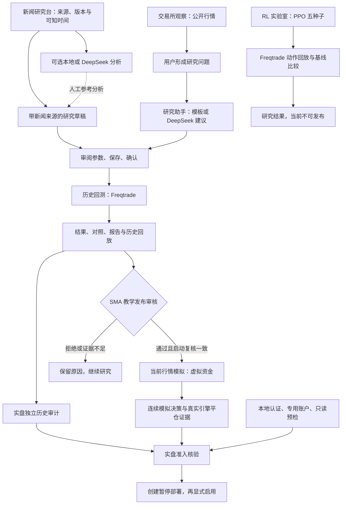

> 恢复说明（2026-10-21）：本文来自原 D 盘项目的开发记录。旧实验编号、指标、测试数量和验收结论属于历史记载，相关原始数据库及模型未恢复，不能作为当前版本的运行证据。当前启动方法见 [C 盘恢复与启动](C盘恢复与启动.md)。

# QuantPilot MVP2：业务逻辑与操作说明

适用版本：0.5.0-mvp2。说明日期：2026-10-15。项目目录：`C:\Users\20705\QuantPilot-Restored`。

## 1. 这个项目究竟用来做什么

QuantPilot 是一个在本机运行的量化研究平台。你先提出一个交易假设，再用历史数据验证，查看收益、风险和逐笔成交，最后判断这个策略是否有资格进入当前行情模拟或受控实盘。

例如，你想研究：“BTC 和 ETH 出现趋势时，短周期均线与长周期均线交叉能否产生有效交易？”平台把这个想法变成一份确定的实验配置，交给 Freqtrade 回测，并保存配置、数据来源、交易记录和报告。以后可以复查这次实验究竟用了什么条件、为什么得到这个结果。

目前主要使用者是本机研究者。两人团队可以共同演示、分别讲解业务与技术；产品尚未实现多用户账户、团队权限和在线协作。

## 2. 先看整体业务关系

图中“交易所观察 → 研究问题”由人完成；页面报价不会自动替换历史实验的数据集。新闻分析结果也不会自动修改研究参数。当前实盘链路已实现控制与风控代码，但真实账户和成交尚未验收。

## 3. 启动与第一次浏览

1. 进入 `C:\Users\20705\QuantPilot-Restored`，双击 `launch.cmd`。
2. 打开 <http://127.0.0.1:8765/>。服务已经运行时直接访问即可。
3. 在“研究总览”查看本地环境是否就绪。
4. 第一次体验建议先看已有实验，再创建新任务，便于理解每一步的输出。

页面打不开时运行 `doctor.cmd`，查看前端、数据及执行器状态。关闭网页不会停止后台服务；退出项目时可在项目目录的 PowerShell 运行 `./stop.ps1`。存在未明确停止的实盘部署时，全局停止会拒绝执行，需要先处理实盘引擎。

## 4. 每个页面负责什么

| 页面 | 你在这里做什么 | 得到什么 |
|---|---|---|
| 研究总览 | 查看环境、保存记录与功能入口 | 确认当前是否具备研究条件 |
| 交易所观察 | 切换 Binance、OKX、Kraken，刷新行情 | 报价、小时 K 线、来源时间与可用状态 |
| 新闻研究台 | 刷新来源、筛选新闻、分析、保存研究 | 有来源和版本的研究背景 |
| 研究助手 | 生成建议、编辑参数、保存并确认 | 固定版本的研究规格与关联实验 |
| 实验工作台 | 直接新建实验，查看排队、日志和结果 | 一次真实历史回测及其证据 |
| 实验对照 | 对比相同条件下的已完成实验 | 策略表现差异 |
| 实验报告 | 阅读指标、研究关联与证据，导出报告 | HTML / JSON 报告 |
| 发布审计 | 检查实验是否满足教学模拟准入 | 通过、拒绝或证据不足的审核记录 |
| 模拟交易 | 创建和控制使用虚拟资金的实例 | 当前行情下的策略运行与账户观察 |
| 历史回放 | 播放已有实验的成交事件 | 对历史交易过程的解释 |
| 数据与溯源 | 查看数据范围、来源与校验信息 | 回答实验数据从哪里来 |
| RL 实验室 | 运行或查看 PPO 五种子研究 | 训练诊断、策略动作和真实引擎对照 |
| 实盘控制 | 查看准入条件、账户预检与部署控制 | 独立受控执行流程，默认未启用 |
| 使用指南 | 查看产品内操作说明 | 原有研究与模拟流程说明 |

## 5. 路线一：完成一个普通量化研究

### 第一步：把想法变成实验规格

进入“研究助手”，生成方式选择“本地模板”，研究需求可以先使用默认的 `BTC ETH SMA trend baseline`，点击“生成可审阅规格”。

本地模板根据预设规则生成配置；选择在线模型时，DeepSeek 根据需求生成受限制的配置建议。当前可用策略是预先实现的 SMA 和 FreqAI 策略，不能输入一句话就生成并执行任意新策略代码。

需要审阅的内容：

| 参数 | 含义与示例 |
|---|---|
| 研究假设 | 想验证的判断，例如趋势均线策略在固定区间的表现 |
| 研究策略 | `SmaTrend` 为 SMA12/48 规则；`FreqaiTrend` 为机器学习历史研究 |
| 标的与周期 | BTC/USDT、ETH/USDT；当前固定 1 小时 |
| 时间区间 | 例如 2025-04-01 至 2025-07-01，结束日期不包含当天，按 UTC |
| 初始资金 | 历史模拟账户本金，例如 10,000 USDT |
| 单笔投入 | 每笔交易的名义投入，例如 1,000 USDT |
| 单边手续费 | `0.001` 表示每一边收取 0.1%，开仓和平仓分别计费 |
| 数据集 | 固定绑定的历史数据版本，用于复查与对照 |

这些资金数值属于回测配置，不表示你已经存入真实资金。

### 第二步：保存并确认

点击“保存草稿”。如果修改了参数，先“保存新修订”，再点击“确认此版本并运行回测”。

保存只产生研究记录；确认才把这一版本送入实验队列。已经确认的研究只读，保留它与实验之间的关系。同一个已保存版本重复确认会打开同一个实验。

这个设计解决的是：模型建议和用户最终同意运行的配置可能不同，因此必须记录实际确认的版本。

### 第三步：查看实验执行

实验进入“实验工作台”，通常经历 `queued（排队）→ running（运行）→ succeeded（成功）`。执行出错会显示 `failed` 和日志。

后台使用独立执行器运行 Freqtrade，保存数据与策略快照、生效配置和原始结果。刷新网页不会重新创建已经提交的任务。新回测仍可能需要访问 Binance 公共市场元数据，网络故障可能导致失败。

成功表示这次计算完成并通过结果核对，不表示策略盈利或允许上线。

### 第四步：解释结果

先看成交数，再看净收益、回撤及逐笔交易；之后到“实验对照”选择同数据、同时间、同资金与费用条件的实验。

余额曲线使用已实现余额，未包含持仓浮动盈亏；回撤也有对应的已平仓账户口径。零成交时胜率未定义。回测采用历史 OHLC 撮合假设，尚未完整模拟盘口、滑点和市场冲击。

在“实验报告”选择该实验，可以导出 HTML 或 JSON。报告汇总可核验的原始结果及相关研究、审核信息，不需要调用大模型生成数字。

“历史回放”则按原始时间展示这些历史成交。播放、暂停和倍速只改变展示过程，不会发出交易订单。

## 6. 路线二：从新闻进入研究

1. 打开“新闻研究台”，先选择 Fed 或 ECB 来源并刷新。
2. 选择一条新闻，查看原文链接、发布时间、首次观察时间和可用时间。
3. 可点击“运行本地提取”；也可明确选择 DeepSeek 后调用分析。本地提取是规则分析，页面会标明来源。
4. 点击“保存研究草稿并审阅”，进入研究助手，审阅假设和参数。
5. 保存、确认后，继续普通回测与报告流程；已经关联实验的新闻可以直接打开已有实验。

**当前新闻与策略的关系：**新闻创建的是带来源的趋势基线研究草稿。分析页面的摘要和假设供人参考，创建草稿不要求先分析，也不会自动将 DeepSeek 分析结果写成策略或参数。需要调整假设时，在研究助手中人工编辑。

例如，一篇新闻发表于 2026 年，而回测使用 2025 年行情。它可以启发今天提出的研究问题，却不能充当 2025 年已经知道的信息，更不能用来解释 2025 年的回测收益。系统保留新闻版本与可知时间，并标记其仅作为研究背景。

当前已成功取得 Fed/ECB 新闻；CoinDesk 在最近验收中连接超时，页面保留失败状态。宏观公告未必明确提及 BTC/ETH，按资产筛选后没有结果不一定是抓取故障。

## 7. 路线三：理解强化学习实验

进入“RL 实验室”，在“持久化研究任务”下拉框选择状态为 `succeeded` 的已有任务。最新记录可能是取消测试任务；选择下面的已完成 ID 可以直接看成果：

`rl-1db76077c9504e0995821a29263f3ee7`

本模块的业务问题是：“一个根据历史价格学习买入、卖出和保持动作的模型，在相同交易条件下表现如何？”

其过程为：

1. 用 BTC 小时行情构造收益率、波动率与均线偏离等六个价格特征。
2. 使用 2025Q1 数据训练 PPO，五个固定随机种子分别训练 8192 步。
3. 在 Q2、Q3 两个开发窗口生成策略动作。
4. 将动作交给真实 Freqtrade 回放，与 SMA 和单次入场持有参照比较。
5. 保留全部种子结果，展示收益、回撤、成交、动作 CSV 和模型文件来源。

两个窗口各有“五个 PPO + 两个基线”，所以共有 **14 行引擎结果**。随机种子影响训练过程，展示全部结果可以避免只挑最好的一次。持有参照使用单次 1,000 USDT 入场和 5% 止损，并非全仓永久持有。

点击每行“查看证据”，可以看对应余额曲线与逐笔成交。训练奖励和 Gym 诊断在另一区域展示，它们与 Freqtrade 的成交口径不同，不能当作相同收益。

新建时填写名称，点击“创建并运行全部研究”；同一时间只允许运行一个任务。最近完整运行约 8 分钟，实际耗时会变化，任务最长 30 分钟。可点击“取消并终止此研究进程”，等待状态变为 `cancelled`。

当前 PPO 在两个窗口的五种子结果全部亏损；Q2 中位收益约 −1.13%，Q3 约 −1.81%。这证明训练、推理、回放和展示流程跑通，尚未证明模型有效。RL 当前不能发布到模拟或实盘。两个窗口均已用于开发，2025Q4 最终保留测试未运行。

## 8. 审核、模拟与实盘怎样衔接

### 发布审计：决定能否进入教学模拟

已完成实验可以进入“发布审计”。系统保存通过、拒绝或证据不足的结论及原因；审核记录不会反过来修改原实验。当前只有符合条件的 SMA 可以创建模拟实例，启动时还要复核证据与文件是否一致。

现有 FreqAI/LightGBM 候选保留原始前视诊断 `flagged`，仍限历史研究。审核通过也不是盈利认证。

### 模拟交易：实时行情，虚拟资金

在“模拟交易”选择通过审核的 SMA 证据创建实例。引擎初始暂停，确认实际健康状态后才可恢复开仓。

它持续根据当前公共行情运行策略，资金和成交为模拟用途；无需登记真实交易账户。小时策略可能长时间没有满足条件的交易，演示时不能把“没有立即成交”判断为系统故障。

### 实盘控制：另一套独立准入

实盘执行范围为 **Binance 现货、SMA、BTC/USDT 与 ETH/USDT**。目前没有跨交易所自动交易，也没有 RL 实盘执行。

| 条件 | 业务作用 |
|---|---|
| 本地认证 | 只有登录本地控制台后才能操作账户功能 |
| 专用账户登记 | 在本机终端隐藏输入凭据并加密保存，页面不接收交易所密钥 |
| 独立历史审计 | 检查至少 30 笔交易、60 天、回撤不超过 10% 和 20 个抽样前视信号等条件 |
| 连续模拟证据 | 两个交易对连续 24 小时的及时决策，且实际模拟引擎至少有一笔已平仓交易 |
| 账户只读预检 | 核验权限、资金、挂单和未解决订单状态，缺失或过期证据阻止入场 |
| 明确启用 | 部署先暂停，实际引擎、保护与对账就绪后才允许启用新入场 |

教学模拟审核通过不会自动获得实盘资格；“模拟运行了一天”也不等于连续决策及成交证据已经满足。

通过准入后的订单仍需检查单笔限额、总敞口、每日损失、报价时效和价差等条件。如果订单请求超时而结果未知，系统记录待核对状态，不盲目重复下单。代码层面由 Freqtrade 负责实际订单提交。

本版本完成的是实盘控制实现和离线测试；真实账户权限、连续 24 小时准入及真实成交尚未完成验收。现在查看这部分业务逻辑不需要配置账户。登记和接口细节另见 [实盘控制说明](mvp2-live-api.md)。

### 三种容易混淆的操作

| 操作 | 实际含义 |
|---|---|
| 暂停新开仓／暂停入场 | 不增加新仓位，已有仓位继续按引擎规则管理退出 |
| 停止引擎／停止进程 | 停止本地进程及持仓保护，不自动平仓，也不代表交易所全部挂单被取消 |
| 确认平仓恢复 | 只读核验账户已经满足恢复条件，不代替用户执行清仓 |

## 9. AI 在项目中分别做了什么

| 能力 | 当前角色 | 产生的输出 |
|---|---|---|
| DeepSeek 研究助手 | 把自然语言整理成受限制的配置建议 | 待审阅的实验规格 |
| DeepSeek 新闻分析 | 分析固定来源的新闻文本 | 摘要、假设与限制说明 |
| 本地模板／本地提取 | 不调用在线模型的确定性处理 | 配置模板或规则分析结果 |
| FreqAI + LightGBM | 根据历史价格特征估计未来六小时收益 | 历史研究中的预测与交易结果 |
| PPO 强化学习 | 学习保持、买入、卖出的动作选择 | 五种子模型、动作记录与回放结果 |

DeepSeek 不负责计算回测收益，也没有直接下单能力。新闻分析、配置助手、LightGBM 和 PPO 是不同的功能链路，并非串起来自动交易的单一 AI。

## 10. 建议你现在按这个顺序体验

1. **研究总览**：确认环境，了解已有记录。
2. **实验报告**：先看一份成功实验的指标和逐笔证据。
3. **历史回放**：理解这些交易在时间上怎样发生。
4. **新闻研究台 → 研究助手**：体验来源如何变成可审阅的草稿，先不必重新回测。
5. **研究助手 → 实验工作台**：用本地模板新建一次 SMA 实验，体验完整执行。
6. **实验对照 → 发布审计 → 模拟交易**：理解结果比较与准入的区别。
7. **RL 实验室**：查看已有成功任务，无需重新训练。
8. **实盘控制**：查看六项条件及未配置状态，理解为什么当前不能直接启用。

可用于查找的已有成果：

| 成果 | ID |
|---|---|
| 新闻关联研究 | `d1467bd7-ba39-5a05-a0a8-ffdb1cc5b653` |
| 关联回测：2025Q2、BTC/ETH、60 笔交易 | `74827205-66ba-4ede-8d6e-b45bcdca2995` |
| PPO 五种子完整实验 | `rl-1db76077c9504e0995821a29263f3ee7` |

三家交易所行情已实际接通；新闻到研究、回测和报告链路已验证；RL 完整实验已执行。实盘目前保持未配置、未启用。完整验证范围见 [MVP2 验收记录](acceptance-mvp2.md)，双人演示节奏见 [使用与答辩手册](MVP2-USER-GUIDE.md)。
